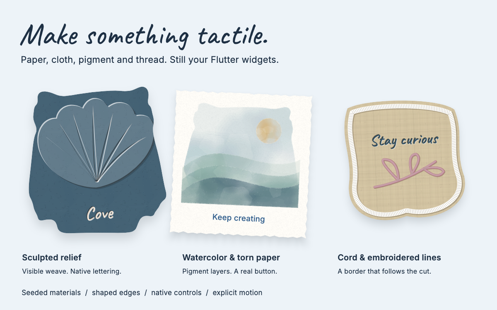
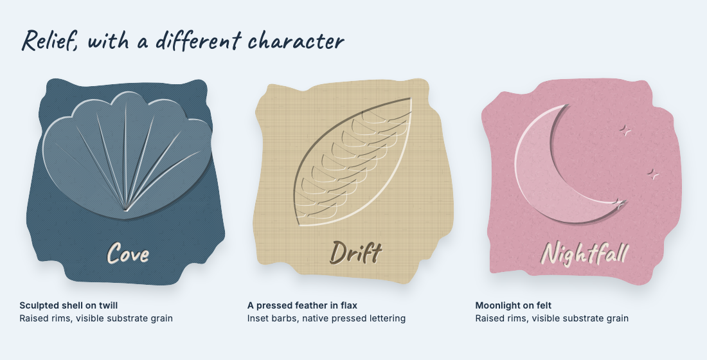
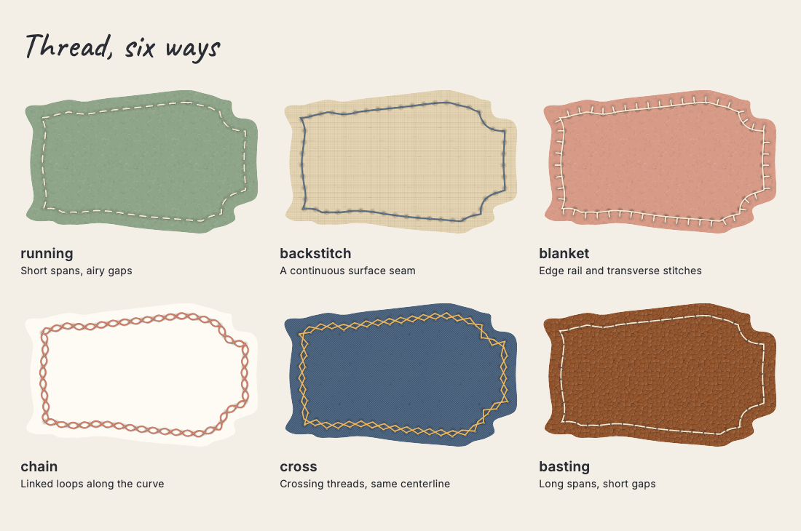
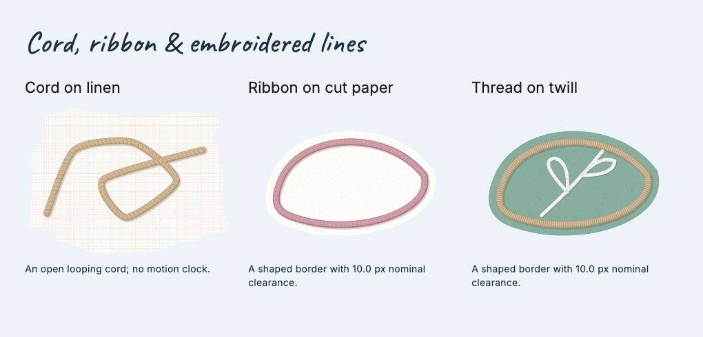

# handcrafted_flutter

**Give your Flutter widgets a handmade surface.**

[Explore the live gallery](https://moisesaguiarjunior.github.io/handcrafted_flutter/) ·
[Run locally](docs/live-gallery.md)



Seeded paper, linen, twill, felt and wood textures, contour-following stitches, organic
contours, watercolor pigment, relief, cord/ribbon bands and composable moving
parts for Flutter.
Text remains text; buttons retain native focus, actions and semantics.

[](https://github.com/moisesaguiarjunior/handcrafted_flutter/actions/workflows/check.yml)

Experimental, licensed under [MIT](LICENSE). Not published on pub.dev.
Latest tagged baseline: [v0.1.0](https://github.com/moisesaguiarjunior/handcrafted_flutter/releases/tag/v0.1.0);
examples and APIs below follow the current source branch.
Tested baseline: Flutter 3.47.9 / Dart 3.13.7. See [compatibility](docs/compatibility.md).

## Paper behind a real control

```dart
import 'package:flutter/material.dart';
import 'package:handcrafted_flutter/handcrafted_flutter.dart';

CraftSurface(
  material: CraftMaterial.paper,
  color: const Color(0xFFFFFDF8),
  shape: const CraftOutline.pigment(seed: 23, broad: true),
  child: TextButton(
    onPressed: openCollection,
    child: const Text('Open collection'),
  ),
)
```

Give the surface normal Flutter constraints. An optional `outline` supplies one
cached silhouette for painting, clipping and child hit testing. Prefer a value
`shape` recipe to retain the cache across equivalent rebuilds. The host supplies
the content padding. `insetCraftPath` derives a bounded polygonal seam from a
closed silhouette, respecting concavities and holes. See [contour seams](docs/contour-seams.md).


## Materials you can compose


Five material algorithms, with explicit colors, grain scale and seed.



Each relief has its own shape and edge lighting. Substrate grain stays visible;
pressed lettering uses native `CraftReliefText`. These are shading approximations.
See the [implemented catalog](docs/materials-and-motion.md) for API/examples and
what remains planned.


Compose the existing paper grain with fiber, fluted, pitted or laid finishes,
then choose clean, torn, handmade or postage edges independently. These are
visual recipes; letterhead stays real text over a substrate. See
[paper recipes and controls](docs/paper-recipes.md).

## Thread, six ways



Choose a thread pattern while keeping the same seam, substrate and native controls.
[Stitch geometry, clearance and playground](docs/stitch-families.md).

## Watercolor on paper


Layer puddles, blooms, drying lines and deposits inside your own closed shape.
Supply pigment, companion and paper colors; the silhouette and its holes remain
unchanged. `paintWatercolor` composes with the existing paper grain. This is a
seeded visual approximation of watercolor.

## Body, tail and tether


Motion examples use original example-owned geometry and supplied progress.

Move the kite's parent part while its ribbon tail keeps its own progress. Hold
the body still to animate only the tail, or combine both. The balloon's string
follows its transformed knot. The original showcase also includes hanging
paper/felt pieces with native controls. These are finite authored examples;
GIFs loop for replay.

## Run the examples

```sh
gh repo clone moisesaguiarjunior/handcrafted_flutter
cd handcrafted_flutter
flutter pub get --enforce-lockfile
cd example
flutter pub get --enforce-lockfile
flutter run -d chrome -t lib/main_gallery.dart
```

- [Live gallery and deployment](docs/live-gallery.md): one navigation shell over existing studies; run `lib/main_gallery.dart`.
- [Cover and relief gallery](example/lib/main_cover.dart): the real compositions behind the README images.
- [Cord/ribbon playground](docs/cord-ribbon-embroidery.md): open paths and contour gaps; run `lib/main_trims.dart`.
- [Gravity/wind comparison](docs/bounded-physics.md): supplied time and realistic/cartoon response; run `lib/main_physics.dart`.
- [Material and motion atlas](example/lib/main_atlas.dart): four sections with live controls.
- [Original showcase](example/lib/main_showcase.dart): keepsake card, hanging pieces and kite.
- [Material playground](example/lib/main.dart): seed, scale, grain and lighting.
- [Shared compositions](example/lib/use_cases.dart): complete runnable widget code.
- [Bounded effects](docs/bounded-effects.md): a mapped pour, droplets and light; run `lib/main_effects.dart`.
- [Rotary recipe](docs/rotary-control.md): native stepping and retargetable wooden artwork; run `lib/main_dial.dart`.
- [Imported artwork recipe](docs/imported-layers.md): source crops, hinges and attached thread; run `lib/main_scenes.dart`.
- [Rendering budget](docs/rendering-budget.md): bounded stress scene and runtime UI/raster timing; run `lib/main_budget.dart` in profile mode.
- [Contour seam study](docs/contour-seams.md): holes, concavities and disappearing necks; run `lib/main_seams.dart`.
- [Paper recipes](docs/paper-recipes.md): stock, edge and finish controls plus native letterhead; run `lib/main_papers.dart`.

Use a local path dependency during development, or pin an immutable Git commit
in an application. Keep source-access credentials outside code and URLs.

## Building blocks

| API | Responsibility |
| --- | --- |
| `CraftMaterial`, `MaterialTextures` | Five seeded textures and explicitly owned raster resources |
| `CraftSurface` | Material behind native Flutter widgets |
| `paintWatercolor` | Layered pigment with explicit colors, seed and granulation |
| `paintCraftRelief`, `CraftReliefText` | Directional motif shading and native raised/inset lettering |
| `pigmentOutline` | Reproducible organic contours |
| `CraftOutline` | Value-based rectangle, rounded rectangle and organic recipes |
| `craftCurveThrough`, `trimCraftPath` | Curved waypoints and explicit arc-length reveal |
| `CraftStrokeStyle`, `paintCraftStroke` | Continuous, dashed or dotted ink and pencil/chalk/wax deposits |
| `paintCraftFreehand` | Bounded solid-pen input by points/strokes, including long scribbles and taps |
| `craftStitchPath`, `paintCraftStitch` | Six bounded thread families over a supplied seam |
| `runningStitchPath`, `paintRunningStitch` | Arc-length stitches and illustrative puncture shading |
| `insetCraftPath` | Bounded winding-aware polygonal inset of a closed silhouette |
| `paperOutline`, `CraftOutline.paper` | Clean, torn, handmade and postage silhouettes |
| `paintPaperFinish`, `paintPaperEdgeFibers` | Clipped stock finish marks and independent fiber fringe |
| `PartPose`, `CraftPart` | Shared paint, input and attachment transforms |
| `CraftImagePart` | Image crop in an artboard rect, optional hinge/pose, native overlay and attachment mapping |
| `paintCraftTrim`, `contourTrimPath` | Cord/ribbon/embroidered bands and nominal edge clearance |
| `CraftPendulum` | Bounded gravity/wind samples with direct or cartoon response, no clock |
| `SceneEntrance` | Finite lifecycle-aware entrance progress |

`SceneEntrance.active` is supplied by the host's viewport or route policy.
Background/TickerMode suspension and reduced motion are handled by the clock.
Pivots use the actual constrained size; attachment mapping must use that same
size. Reserve parent space for moving touch targets.

Actor examples use authored motion. `CraftPendulum` separately models one rigid
suspended mass with constant gravity/wind; flexible cloth/rope, shared wind fields
and fluid dynamics remain future work. Punctures are shading; textures are cached
per surface. Insets approximate curves with polygons and have explicit work limits.
Glyph shading uses bounded offscreen layers;
phone performance remains unmeasured.

## Curves, ink and completed paths


Build a smooth route through waypoints, or supply your own Flutter `Path`. Choose
continuous, dashed or dotted ink independently of pen, broad marker or brush
treatment, or pencil, chalk and wax deposits. Explicit progress reveals the line by distance without creating a
clock. Paint a quiet track behind a solid prefix to show a completed route.

Run `flutter run -d chrome -t lib/main_strokes.dart` from `example/`.
See [drawing recipes and examples](docs/drawing-strokes.md).

### Cord, ribbon and embroidered lines



Draw raised bands over textures or follow the actual cut with an optional edge gap.
[API and runnable playground](docs/cord-ribbon-embroidery.md).

## Development

```sh
bash tool/check.sh
flutter test tool/capture_cover.dart
flutter test tool/capture_showcase.dart
bash tool/encode_showcase.sh
flutter test tool/capture_motion.dart
bash tool/encode_motion.sh
flutter test tool/capture_atlas.dart
bash tool/encode_atlas.sh
```

Captures are explicit and do not regenerate goldens. See the [capture recipe](docs/showcase.md),
[reuse map](docs/reuse.md), [contribution rules](CONTRIBUTING.md) and
[documentation index](docs/README.md).

Follow the [delivery tasklist](docs/tasklist.md) and
[independent review record](docs/reviews/local-review-record.md).

See the [material and movement roadmap](docs/roadmap.md) for current/planned
capabilities and [integration contracts](docs/integration.md) for Fluvie and
Social Studio adapter boundaries. The [executable consumer integration](docs/consumer-video-integration.md)
shows versioned material arguments, declared media and the existing video export path.

## License

Code and original documentation/media: [MIT](LICENSE). Clipper2 retains BSL-1.0.
Example-only Inter and
Caveat fonts retain their bundled SIL OFL 1.1 notices. See
[dependency notices](docs/dependencies.md) and [provenance](docs/provenance.md).
