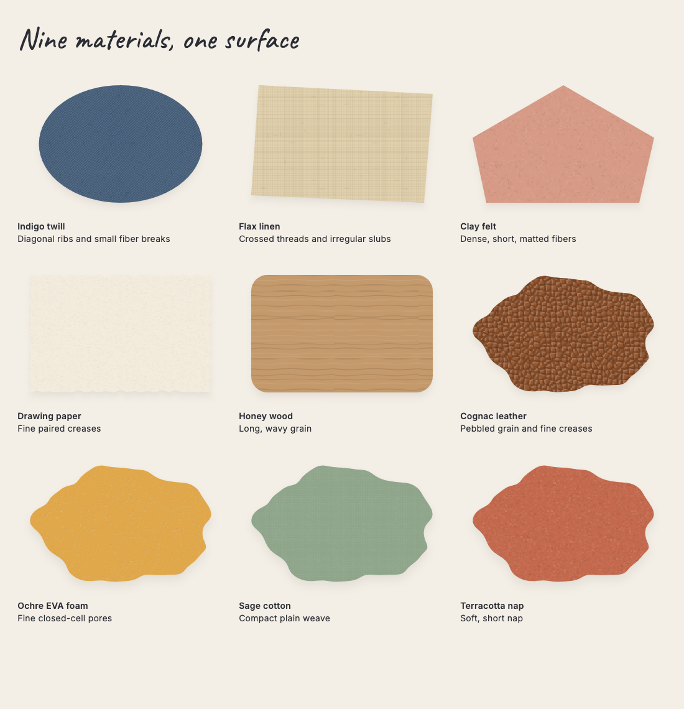
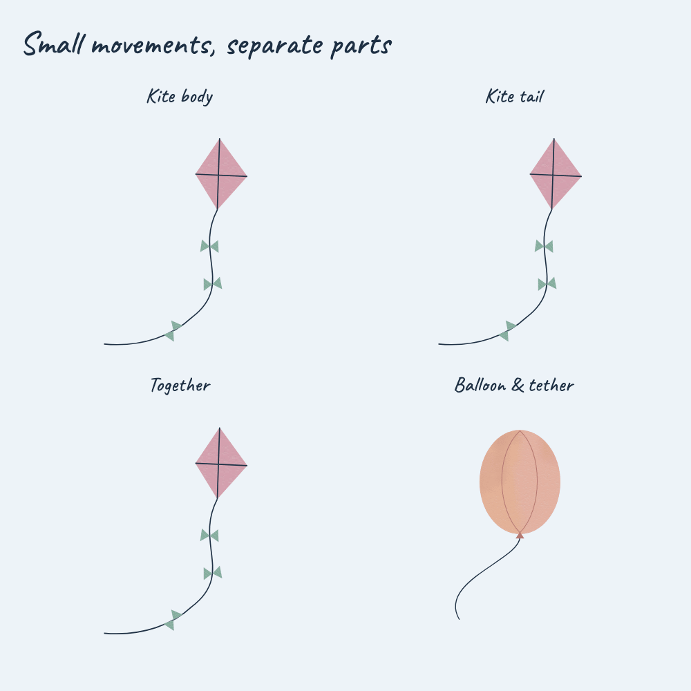

# handcrafted_flutter

**Give your Flutter widgets a handmade surface.**


Seeded paper, linen, twill, felt and wood textures, running stitches, organic
contours, watercolor pigment, relief and composable moving parts for Flutter.
Text remains text; buttons retain native focus, actions and semantics.

[](https://github.com/moisesaguiarjunior/handcrafted_flutter/actions/workflows/check.yml)

Experimental version 0.0.1, licensed under [MIT](LICENSE). Not published on pub.dev.
Tested baseline: Flutter 3.47.9 / Dart 3.13.7. See [compatibility](docs/compatibility.md).

## Paper behind a real control

```dart
import 'package:flutter/material.dart';
import 'package:handcrafted_flutter/handcrafted_flutter.dart';

CraftSurface(
  material: CraftMaterial.paper,
  color: const Color(0xFFFFFDF8),
  shape: const CraftOutline.pigment(seed: 23, broad: true),
  child: TextButton(
    onPressed: openCollection,
    child: const Text('Open collection'),
  ),
)
```

Give the surface normal Flutter constraints. An optional `outline` supplies one
cached silhouette for painting, clipping and child hit testing. Prefer a value
`shape` recipe to retain the cache across equivalent rebuilds. The host supplies
the seam path; the package does not yet calculate a general inset contour.

## Materials you can compose



Five material algorithms, with explicit colors, grain scale and seed. The three
fabric impressions above keep the fabric grain visible inside original botanical motifs.
Their captions are native widgets; the pressed lettering uses `CraftReliefText`.
See the [implemented catalog](docs/materials-and-motion.md) for API/examples and
what remains planned.

## Watercolor on paper


Layer puddles, blooms, drying lines and deposits inside your own closed shape.
Supply pigment, companion and paper colors; the silhouette and its holes remain
unchanged. `paintWatercolor` composes with the existing paper grain. This is a
seeded visual approximation of watercolor.

## Body, tail and tether



Move the kite's parent part while its ribbon tail keeps its own progress. Hold
the body still to animate only the tail, or combine both. The balloon's string
follows its transformed knot. The original showcase also includes hanging
paper/felt pieces with native controls. These are finite authored examples;
GIFs loop for replay.

## Run the examples

```sh
gh repo clone moisesaguiarjunior/handcrafted_flutter
cd handcrafted_flutter
flutter pub get --enforce-lockfile
cd example
flutter pub get --enforce-lockfile
flutter run -d chrome -t lib/main_atlas.dart
```

- [Material and motion atlas](example/lib/main_atlas.dart): four sections with live controls.
- [Original showcase](example/lib/main_showcase.dart): keepsake card, hanging pieces and kite.
- [Material playground](example/lib/main.dart): seed, scale, grain and lighting.
- [Shared compositions](example/lib/use_cases.dart): complete runnable widget code.
- [Bounded effects](docs/bounded-effects.md): a mapped pour, droplets and light; run `lib/main_effects.dart`.
- [Rotary recipe](docs/rotary-control.md): native stepping and retargetable wooden artwork; run `lib/main_dial.dart`.
- [Imported artwork recipe](docs/imported-layers.md): source crops, hinges and attached thread; run `lib/main_scenes.dart`.
- [Rendering budget](docs/rendering-budget.md): bounded stress scene and runtime UI/raster timing; run `lib/main_budget.dart` in profile mode.

Use a local path dependency during development, or pin an immutable Git commit
in an application. Keep source-access credentials outside code and URLs.

## Building blocks

| API | Responsibility |
| --- | --- |
| `CraftMaterial`, `MaterialTextures` | Five seeded textures and explicitly owned raster resources |
| `CraftSurface` | Material behind native Flutter widgets |
| `paintWatercolor` | Layered pigment with explicit colors, seed and granulation |
| `paintCraftRelief`, `CraftReliefText` | Directional motif shading and native raised/inset lettering |
| `pigmentOutline` | Reproducible organic contours |
| `CraftOutline` | Value-based rectangle, rounded rectangle and organic recipes |
| `craftCurveThrough`, `trimCraftPath` | Curved waypoints and explicit arc-length reveal |
| `CraftStrokeStyle`, `paintCraftStroke` | Continuous, dashed or dotted pen/marker/brush ink |
| `runningStitchPath`, `paintRunningStitch` | Arc-length stitches and illustrative puncture shading |
| `PartPose`, `CraftPart` | Shared paint, input and attachment transforms |
| `SceneEntrance` | Finite lifecycle-aware entrance progress |
| `authoredKiteTail` | An artwork preset with bounded authored motion |

`SceneEntrance.active` is supplied by the host's viewport or route policy.
Background/TickerMode suspension and reduced motion are handled by the clock.
Pivots use the actual constrained size; attachment mapping must use that same
size. Reserve parent space for moving touch targets.

Motion is authored, not a physics solver. Punctures are shading, not displaced
cloth. Textures are cached per surface.
General contour insets, additional material/edge/stitch families and physical
cloth/wind remain future work. Glyph shading uses bounded offscreen layers;
phone performance remains unmeasured.

## Curves, ink and completed paths


Build a smooth route through waypoints, or supply your own Flutter `Path`. Choose
continuous, dashed or dotted ink independently of pen, broad marker or brush
treatment. Explicit progress reveals the line by distance without creating a
clock. Paint a quiet track behind a solid prefix to show a completed route.

Run `flutter run -d chrome -t lib/main_strokes.dart` from `example/`.
See [drawing recipes and examples](docs/drawing-strokes.md).

## Development

```sh
bash tool/check.sh
flutter test tool/capture_showcase.dart
bash tool/encode_showcase.sh
flutter test tool/capture_atlas.dart
bash tool/encode_atlas.sh
```

Captures are explicit and do not regenerate goldens. See the [capture recipe](docs/showcase.md),
[reuse map](docs/reuse.md), [contribution rules](CONTRIBUTING.md) and
[documentation index](docs/README.md).

See the [material and movement roadmap](docs/roadmap.md) for current/planned
capabilities and [integration contracts](docs/integration.md) for Fluvie and
Social Studio adapter boundaries.

## License

Code and original documentation/media: [MIT](LICENSE). Example-only Inter and
Caveat fonts retain their bundled SIL OFL 1.1 notices. See
[dependency notices](docs/dependencies.md) and [provenance](docs/provenance.md).
