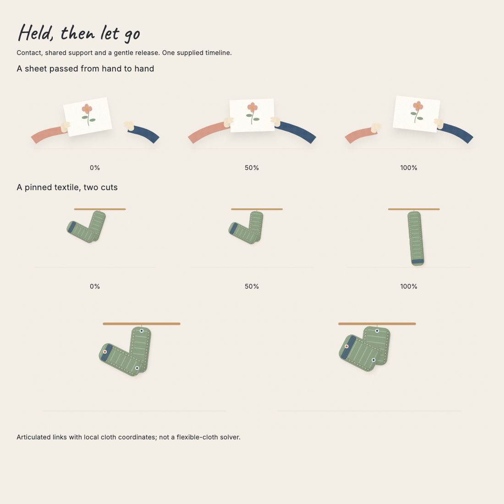
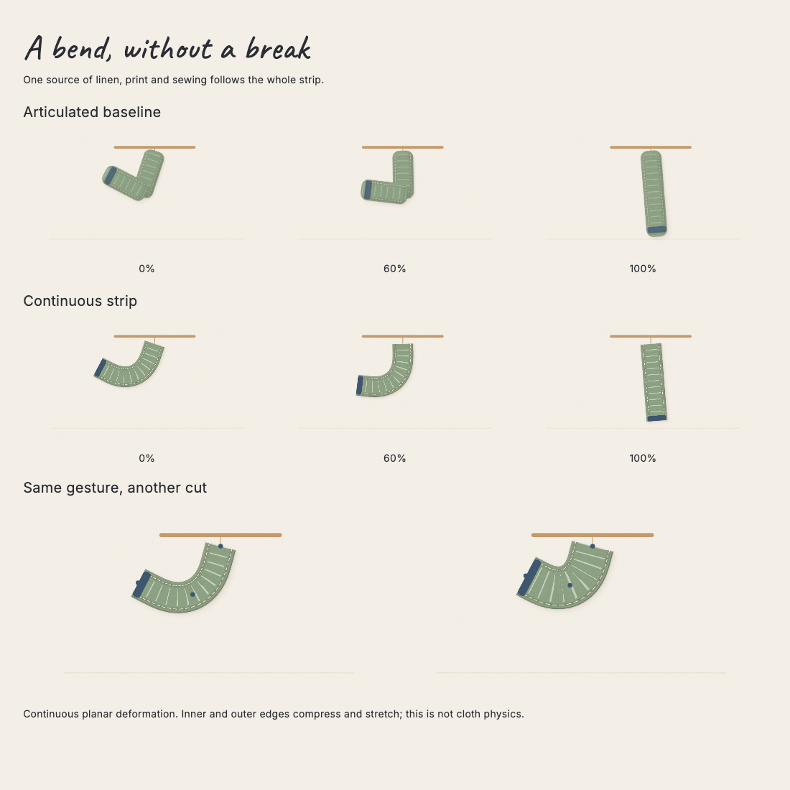

# Contact and articulated cloth

The example-owned study at `?study=contact` demonstrates a paper handoff and
an articulated textile using existing package primitives. These are synthetic
construction proofs, not a character kit or a flexible-cloth solver. Artwork,
acting, camera, contact ownership and editing remain consumer responsibilities.



[Finite gesture preview](assets/contact-and-cloth.gif). The GIF repeats for
inspection; the actual study plays once, stops, and can be scrubbed or reversed
by supplying a different progress. It does not introduce another capture clock.

## Reuse and create

Searched part transforms, attachment mapping, imported masks, curved bands,
prepared volume/light, textile coordinates and finite timeline controls.
`PartPose.matrixFor` and `mapPoint` already solve the rigid transform contract;
`CraftPart` paints the sheet with that same transform. Flutter owns the stack
and clipping. `MaterialTextures`, prepared `CraftVolume` profiles and a prepared
`CraftStitchFrame` supply material, relief and sewing. `SceneEntrance` provides
the optional live clock with host activity and lifecycle suspension.

New code stays in the example: `contact_poses.dart`, `contact_artwork.dart` and
`contact_study.dart`. No public package API, runtime dependency or application
artwork was added. Source baseline: `9eda99d` / version 0.4.0.

## Pass the paper

The sheet is 184 by 136 artboard units. Both fingers and rear palms use the
sheet matrix plus an explicit free-hand offset; the supporting hand has zero
offset. The receiving hand arrives by progress .32, before the giving hand
starts withdrawing at .68. At least one hand supports the sheet at every time.

Paint order is intentional: sleeves and rear palms, the sheet in `CraftPart`,
then narrow foreground fingers. The central print rectangle is outside the
finger silhouettes. No automatic depth sorting, alpha hit mask or anatomical
constraint is inferred. The whole board is decorative and excluded from input
and semantics; actual controls and explanatory text remain native outside it.

The contact guides show held points in blue and free points in coral. Turning
or resizing the whole artboard also transforms the paper and both hand layers.
No contacts are stored in screen coordinates.

## Let the textile settle

Two different cuts share the same authored phases: hold, proximal release,
delayed distal release and rest. The elbow is mapped from the proximal link's
endpoint; the distal pivot is placed at that mapped point. The shoulder stays
fixed. No integration state or frame history is required.

Both links paint from the same fixed material-space source and prepared seam;
the distal segment uses the proximal material length as its source offset.
Grain and printed marks remain attached to each link. Prepared profiles and
sewing are reused between frames; the directional light is converted to each
link's local rotation. Ground separation is a fixed illustrative shadow setting,
not inferred 3D contact or mutual cloth occlusion.

**Boundary demonstrated:** rigid composition can retain joint attachments,
local texture coordinates, finite lag and a stable final pose for two cuts.
The overlapping elbow exposes the segmentation. This does not prove a continuous
flexible fold, stretch-free deformation, fabric memory, self-shadowing or cloth
physics. The opt-in continuous-strip proof below now compares controlled planar
deformation with this baseline; it does not justify a public surface-warp API. `CraftBand`
already supplies static curved geometry but does not transport a printed surface
through an arbitrary animated fold.

## Supply the existing clock

From the example package, render the artwork directly:

```dart
ContactArtwork(
  progress: frameProgress, // finite 0..1, supplied by the caller
  cloth: false,
  cameraAngle: 0.08,
)
```

`ContactArtwork` is an example widget, not importable from the hosted library.
Video consumers reuse the recipe and pass their existing Fluvie frame progress;
they must not mount the live `ContactStudy` clock inside an externally timed
export. The live study supports Play/Pause, a native progress slider, two cuts
and a whole-composition angle. Reduced motion displays the final pose and
disables playback/scrubbing. `active` is a host-supplied visibility policy;
scroll visibility is not automatically detected. No work is scheduled at rest.

## Reproduce and inspect

```sh
cd example
flutter test test/contact_study_test.dart
cd ..
flutter test tool/capture_contact.dart
```

The capture writes the board to `docs/assets/contact-and-cloth.png` and 48
640 by 720 frames to `build/contact-frames/`. The first 40 sample a finite
gesture, followed by an eight-frame hold. Encode at 10 fps with FFmpeg for a
short inspection clip. Tools, frames and documentation media are Git-only and
do not add runtime library assets.

Behavior checks cover continuous support, clear central print, mapped anchors,
two cuts, two viewport scales, camera rotation, out-of-order raster equality,
finite hold/rest, enlarged-text controls, host inactivity and reduced motion.
This is desktop test/capture evidence. Export speed is not a UI/raster frame
budget; physical Android/iPhone profiling, consumer visual acceptance and
flexible-cloth fidelity are not established here.


## Continuous printed strip

Choose **Let cloth settle → Continuous strip** to compare an uninterrupted
curved strip with the original articulated links. The default remains the
previous recipe, with its existing captures unchanged.



[Finite comparison clip](assets/continuous-cloth.gif) repeats only for inspection.
Pass `continuous: true, cloth: true` to example-owned `ContactArtwork` when
sampling an external timeline. All playback, native controls, reduced-motion and
host-activity policies are the existing ones.

`ContinuousClothFrame` samples the same `ClothPose` angles and builds one bounded
centerline. `CraftBand` supplies its contour, rounded cross-section, lighting and
shadow. The example does not implement a second volume shader. The shoulder is
pinned and the centerline keeps the cut's source length. The bend is deliberately
broad enough for both cuts; tests check that all triangles retain positive area
through 101 gesture samples for each cut.

One cached 2× image per cut contains linen, printed marks, cuff and sewing.
Twenty-four strips transport that fixed source through 48 affine triangles.
Neighboring patches share vertices; their internal clips are not independently
antialiased. `mapSource` uses exactly the same piecewise affine mapping as the
painted patches, including their diagonal split. Native widget text is never
baked into this image: it contains only decorative material and marks.

The same image survives playback/replay; at most two source images live per
mounted artwork (108×400 and 148×324, 364,608 uncompressed RGBA bytes together).
The owner disposes both on unmounting; the borrowed `MaterialTextures` owner
remains separate. Pictures used for recording the source are disposed even if
preparation fails. Source image dimensions stay fixed as the viewport changes.
The current prepared band is reused when only contact guides or the parent
camera change. A new progress samples new geometry; no unbounded pose cache or
global texture cache is introduced.

**What this proves:** uninterrupted planar geometry, material-space print/sewing,
a retained shoulder, finite delayed release and independent frame sampling for
two cuts. **What it does not prove:** isometric deformation, cloth elasticity,
out-of-plane folds with a visible reverse face, self-shadowing or fabric memory.
The inner rail compresses and the outer rail stretches; the shadow uses authored
ground separation. The short source is not an arbitrary deformable document.

Reproduce with `flutter test test/continuous_cloth_test.dart` in `example/` and
`flutter test tool/capture_continuous_cloth.dart` in the repository root.
Raster probes track actual printed marks through the mapped positions and check
opacity at internal joins. Ownership probes count source-image creation and
explicit disposal through a second cut and replay. Negative controls shift the
source print and omit disposal; both must fail. These are desktop/Chrome test
and capture checks, not physical-device performance evidence or exact raster
parity between rendering engines.
