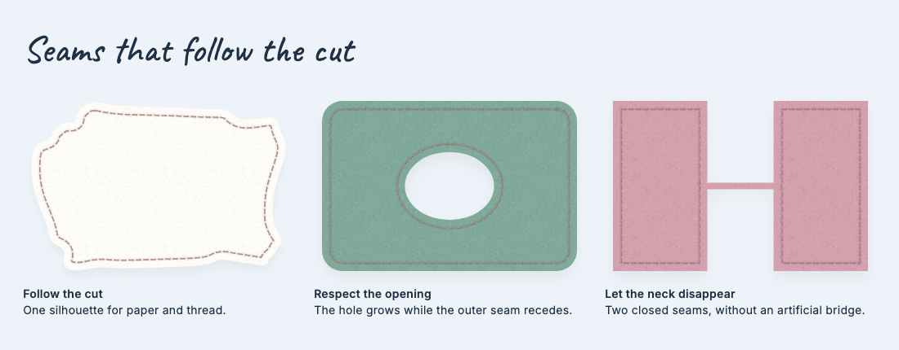

# Contour-following seams

Run `flutter run -d chrome -t lib/main_seams.dart` from `example/`.



`insetCraftPath` offsets a closed filled silhouette inward. It normalizes winding
using the original nonzero/even-odd fill rule, shrinks outside borders and grows
holes. Concave necks can collapse into separate islands; an exhausted shape
returns an empty path. It does not scale a silhouette around its center.

```dart
// Prepare and retain these paths until size, outline or inset changes.
final seam = insetCraftPath(outline, distance: 12);
canvas.save();
try {
  canvas.clipPath(outline);
  paintRunningStitch(canvas, seam,
    thread: threadColor, width: 1.2, compression: .4);
} finally {
  canvas.restore();
}
```

The offset is polygonal, not an exact Bezier construction. Arc-length sampling
uses at most 0.5 logical pixels per span by default (configurable 0.25..2), with
1/256-pixel coordinate quantization and round joins. A span's omitted curve can
deviate by up to half its arc length; offset/rounding and topology also depend on
the source geometry. Do not interpret sampleSpacing as a certified final offset
error bound. Features below quantization precision are unsupported.

Distance is 0..128. Zero distance gives a fresh exact copy, preserving curves and
fill rule. Inputs must be closed, finite and within +/-8192 logical coordinates;
shared limits are 32 contours / 8192 total arc length. Flattening admits 4096
samples and Clipper output admits 8192 vertices. The returned path also follows
the shared contour/length limits. Invalid or oversized requests throw before
painting. An output intersection keeps the source silhouette authoritative.

Reserve thread/relief clearance **in addition** to approximation: at least
`width * 4 + sampleSpacing` for the existing puncture painter. Clip final ink to
the original material, including holes. Neither a seam nor surface clipping
reserves native text padding or a minimum touch target; the application does.

The example's `PreparedSeamGeometry` retains one source/offset pair per effective
size. It is an example helper, not a prepared-path package API or shared cache.
`SeamedSurface` supplies that same source to CraftSurface and the stitch painter.
The card showcase now follows its actual paper cut; the felt label has an organic
silhouette. The material playground uses this offset instead of scaled contours.
The original circular fabric hoops retain their exact concentric seam recipe.

Geometry is adapted through the pinned `clipper2` 0.0.3 dependency (BSL-1.0),
using its union and round polygon-offset operations. The adapter and original
synthetic examples are MIT. See [dependency notices](dependencies.md).

Checks cover requested rectangle margins, fill rules/winding, expanded holes,
concavities, disappearing necks, empty output, bounded input/output and full
thread/puncture ink containment on an organic specimen. Native controls and
captions are tested at 320px through 250% text and responsive column breakpoints.
Capture commands are explicit; ordinary tests do not regenerate references:

```sh
flutter test tool/capture_seams.dart
flutter test tool/capture_showcase.dart
```

Inspect captures before copying them to docs/assets. This delivery deliberately
updates hero/keepsake documentation images for the new seam/label design; no
golden baseline is updated to make a failing test pass. The five core geometry
tests also pass in headless Chrome, exercising the dependency's web integer path.
Interactive gallery behavior and native-device performance remain unverified.
