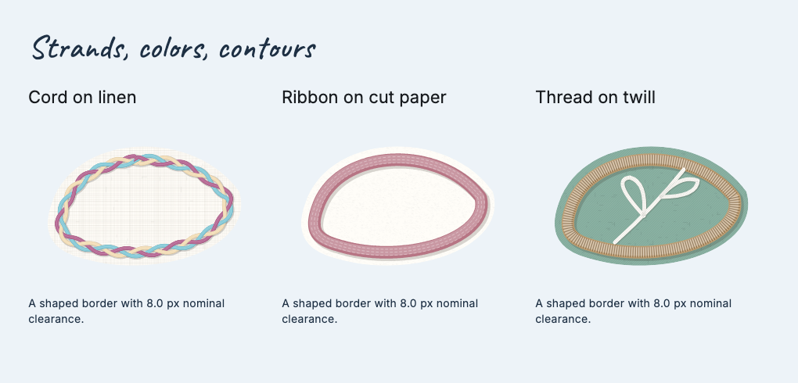
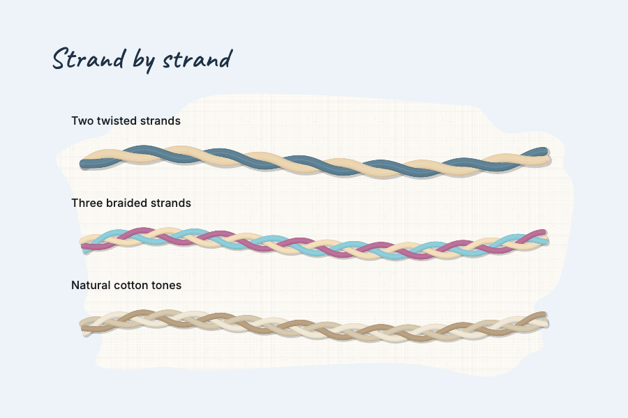

# Cord, ribbon and embroidered lines

Three raised-band treatments share the same centerline: twisted-cord hatching,
fine ribbon fibers and closely spaced embroidered thread. They compose over
paper, linen, twill or any caller-supplied substrate. Relief is directional
shading, not physical displacement, tension or a stitch/needle simulation.

```dart
final cord = craftCurveThrough(const [
  Offset(20, 140), Offset(70, 35), Offset(145, 90), Offset(230, 45),
]);
paintCraftTrim(canvas, cord,
  color: const Color(0xFFB09161), kind: CraftTrimKind.rope,
  width: 10, pitch: 6, relief: .8);
```

Use any open or closed Path. Empty or single-point paths have no tangent and
paint nothing. For input drawing with isolated taps or long scribbles, see the
separate [freehand request](requests/freehand-capture.md).

## Following the actual cut

Prepare the centerline outside paint and invalidate it when the outline, width,
gap or sampling changes:

```dart
final border = contourTrimPath(outline, width: 8, gap: 10);
canvas.save();
canvas.clipPath(outline); // same silhouette as the substrate
paintCraftTrim(canvas, border,
  color: const Color(0xFFB77584), kind: CraftTrimKind.ribbon, width: 8);
canvas.restore();
```

`gap: 0` places the nominal band's body near the edge; `gap: 10` reserves ten
logical pixels before its body. The centerline recedes by gap + half width +
sampleSpacing. This includes a sampling reserve, not an exact Bezier guarantee.
Cast shadow is excluded from gap and may enter that space. Holes expand, narrow
regions can collapse, and final clipping remains the caller's responsibility.
Native controls and semantics remain ordinary widgets above/around the painting.

## Cost and ownership

- Width 1..32, pitch 2..32, relief/texture 0..1; finite nonzero light direction.
- Shared 32-contour / 8192 arc-length limits; coordinates within +/-8192.
- At most 2048 texture stations, checked even when texture is zero. Up to six
  short fiber draws per station for ribbon, plus three body/shading draws.
- Invalid parameters/work budgets throw before painting. No timers, images,
  blur/saveLayer, global cache or retained resource ownership.
- Texture marks stay within the round band, including open endpoints. Reserve
  one band width around the centerline for the illustrative cast shadow.

## Runnable composition

From example/, run `flutter run -d chrome -t lib/main_trims.dart`.
Native sliders control width, nominal gap and relief. Three original plates show
an open cord on linen, a border on shaped paper and an embroidered sprig on twill.
The border and substrate use the same outline. This is a new example proposal,
not approval to change an existing application's visual design.

Reproduce its image with `flutter test tool/capture_trims.dart`; output is
`build/trims/trim-studies.png`. The tracked documentation image is an explicit
capture of these widgets, not a golden baseline or performance result.

## Twisted color strands



Supply `strandColors` (2..6 host-owned colors) with the existing rope kind:

```dart
paintCraftTrim(canvas, centerline,
  color: baseColor, width: 14, pitch: 6,
  strandColors: [rose, blue, cream]);
```

Each yarn follows its own continuous path across the centerline. Crossing
segments are ordered by local depth, so the strand on top changes along the
braid. Two colors form a twist; three or more form an interlaced braid. Each
strand has its own cylindrical light and fine longitudinal filaments. There is
no flat color backing or cross-band hatch in palette mode. Ground shadows are
painted once per strand, avoiding density-dependent dark buildup.



The fixed close-ups in the live study use this same painter at 26 logical pixels.
The preceding contour/open samples follow the width/gap/relief controls. Run
`flutter test tool/capture_cord_detail.dart` to reproduce the close-up image.

Color remains independent of grain strength; texture zero keeps the braid.
Closed contours use whole repeats so their phase meets at the seam. The repeat
length is at least 4.4 band widths or twice pitch × strand count. This is an
illustrative construction, not rope tension or physical fibers. Omitting the
palette keeps legacy single-color output. Other trim kinds reject strand colors.
The base color is for legacy single-color painting; a palette defines the actual
yarn colors and alpha, including transparent strands without an opaque backing.

The existing contour helper still supplies the nominal border gap. The live
study can switch between an open curve and the substrate contour, retaining
width/gap/relief controls. In addition to the existing path/station limits,
colored rope caps work at 8192 strand samples, checked before drawing. Denser or
longer paths may need a larger pitch; this decoration guard is not a validity
rule for a user's freehand drawing.

Budget validation uses the exact sampling plan before painting. At most 8192
strand samples are prepared. Nine cross-width profile vertices encode shading
and fine filaments without additional alpha coats. Shared-edge strips generate
48 vertices per adjacent pair, with bounded semicircular end caps on open paths.
One temporary native mesh is recorded and disposed; ground shadows are painted
once per strand. Depth ties retain arc order. The limit is a work bound, not a
measured mobile frame rate. Fractional yarn alpha stays independent of sampling;
separate crossing yarns still composite normally.
