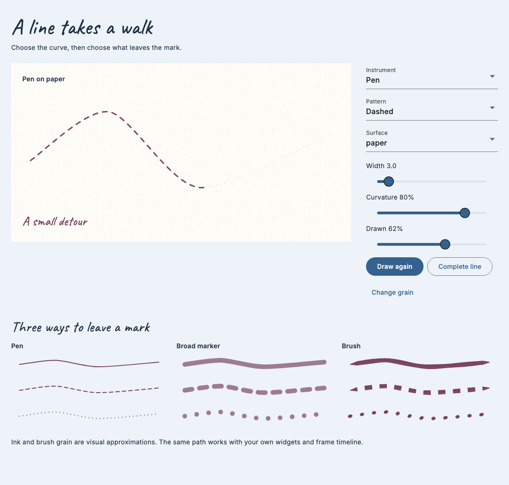

# Curved lines and drawing instruments

Geometry, pattern, ink treatment and progress are independent. A curved dashed
pen line and a continuous brush line can use exactly the same centerline. None
of these functions creates a ticker or reads wall-clock time.

## Build or supply a path

```dart
final route = craftCurveThrough(const [
  Offset(20, 70),
  Offset(90, 20),
  Offset(180, 110),
  Offset(280, 50),
]);
```

The helper builds an open cubic curve through 2..64 waypoints. Curvature 0 makes
straight segments; the default is .7. Endpoints are preserved. Handles may
overshoot intermediate waypoint bounds, so reserve space around the artwork.
Adjacent duplicate points are rejected. For authored geometry, pass your own
Flutter `Path` directly to the painter instead of rebuilding it as waypoints.

## Choose a pattern and an instrument

```dart
paintCraftStroke(
  canvas,
  route,
  color: const Color(0xFF79445F),
  style: const CraftStrokeStyle(
    tool: CraftStrokeTool.brush,
    pattern: CraftLinePattern.dashed,
    width: 10,
    dash: 9,
    gap: 6,
    variation: .5,
  ),
  seed: 23,
  progress: .6,
);
```

| Choice | Behavior |
| --- | --- |
| `solid` | Continuous centerline; progress 1 completes it |
| `dashed` | Dash and centerline gap measured in logical pixels along the curve |
| `dotted` | Dot centers spaced by width + gap; brush dabs retain gaps |
| `pen` | Crisp round-ended ink; normally choose a narrow width |
| `marker` | Translucent ink at 68% of supplied alpha; choose a broad width for a marker |
| `brush` | Tapered, seeded variable-width ribbon with fine bristle highlights |

Width is explicit: changing the instrument does not silently change application
layout. Round caps extend into gaps; use `gap > width` for visibly separated
dashes. The playground supplies suggested widths and spacing for instruments.
Seed/variation affect brush grain and width, not the centerline. A brush's
nominal width is its maximum; the ends of open paths taper. These effects are
illustrative ink, not fluid dynamics, actual pen pressure or wet watercolor.

## Draw completed and remaining portions

```dart
// A quiet dashed track remains visible ahead of the completed section.
paintCraftStroke(canvas, route, color: const Color(0xFFB5B8B2),
  style: const CraftStrokeStyle(pattern: CraftLinePattern.dashed));
paintCraftStroke(canvas, route, color: const Color(0xFF79445F),
  style: const CraftStrokeStyle(width: 3), progress: completion);
```

Progress 0 paints nothing and 1 completes the selected pattern; a dashed line
does not automatically become solid. Distance is measured globally across
contours in order, while dash/dot phase restarts at each contour. Revealing more
does not reroll brush grain or move earlier dashes. Caps and dabs can extend
beyond the exact reveal point. `trimCraftPath(route, progress: completion)` is
also available when another painter should own the ink treatment.

Use `SceneEntrance` for a live finite reveal, or pass resolved frame progress
from an external timeline such as Fluvie. Follow the [integration guide](integration.md):
the frame renderer owns time. Reduced motion should settle automatic reveals;
user-controlled scrubbing can remain explicit.

## Run the playground

From `example/`: `flutter run -d chrome -t lib/main_strokes.dart`.
Try each instrument/pattern, scrub progress, change curvature, switch between
paper/linen/felt, or replay the finite drawing. The nine static combinations
below the controls use the same painter. They are arranged continuous, dashed,
then dotted for each instrument. Native controls retain focus and semantics.
The example flows down to 320 logical pixels with text scaled up to 250%.



Explicit capture: `flutter test tool/capture_strokes.dart`, then copy
`build/showcase/stroke-playground.png` to `docs/assets/stroke-playground.png`
after visual inspection. The capture is 1100x1050 at pixel ratio 1, uses the
bundled Inter/Caveat fonts and the SDK's Material Icons font, and draws at 62%.
Ordinary tests do not regenerate images or golden baselines.

## Limits and ownership

Widths are 0.5..32; dash/gap must be at least 0.5; progress and variation are
0..1. Inputs are validated before painting. Shared geometry work is bounded by
32 contours and 8192 logical pixels, matching running stitches. Brush ribbons
sample at two-pixel intervals, so subpixel curvature and sharp joins are visual
approximations. Different Flutter engines need not produce identical pixels.

Cache stable paths outside paint in production compositions. The host owns
clipping, padding, text labels, actions and hit regions. These are centerline ink
tools, not a silhouette offset solver: contour-following inset seams remain a
separate roadmap item. Phone performance remains unmeasured.
