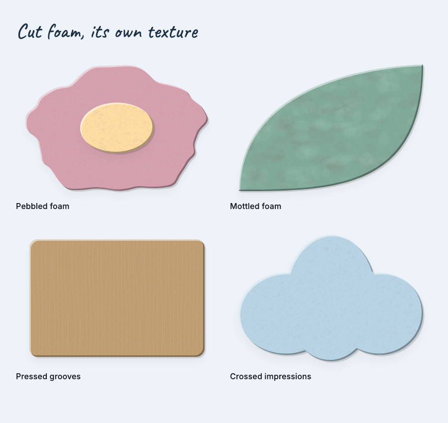

# EVA foam: grain, finish and layers

EVA is a fine-pore substrate, distinct from woven linen, felt fibers and paper
creases. `CraftMaterial.eva` reuses MaterialTextures ownership, scale, clipping
and disposal. It is appended to the enum, preserving previous material seeds;
consumers with exhaustive material switches must add its case for 0.3.0.



The shapes in this example are original procedural specimens. No application
illustration, atlas, school scene or design inventory is included. These are
visual approximations; accepting a generated image as a design reference does
not make its bitmap a procedural material.

Compose three independent things:

1. Choose an EVA fill, color and grain seed with CraftSurface or MaterialTextures.
2. Add `paintFoamFinish` with pebbled cells, mottled color islands, directional
   grooves or crossed impressions. Colors, contrast, seed and scale belong to
   the host. Marks clip to the supplied closed shape, including its holes.
3. Give each cut the existing `paintCraftRelief(kind: CraftReliefKind.raised)`
   edge and optional native cast shadow. Paint lower cuts before upper cuts.
   Reserve padding for shadows. This is beveled light, not physical extrusion.

```dart
textures.paint(canvas, cut,
  material: CraftMaterial.eva, color: foamColor);
paintFoamFinish(canvas, cut,
  finish: FoamFinish.grooved, ink: grooveColor, seed: 71);
paintCraftRelief(canvas, cut,
  kind: CraftReliefKind.raised, depth: 4);
```

Prepare and dispose MaterialTextures through its existing owner contract. The
finish has no image cache, layer or clock. Bounds cap at 2048 per axis and shared
path budgets apply before painting, even at zero contrast. At most 900 motifs
or 512 directional groove pairs are emitted. Native text/actions belong above
or outside decoration, not inside a scaled illustration.

Run the hosted gallery with `?study=foam`, or capture the same FoamStudies widget:
`flutter test tool/capture_foam.dart`. Native contrast/depth controls let you
compare finishes on the actual grain. Large text remains native; source artwork
is neither a target mask nor a source of private layout coordinates.
