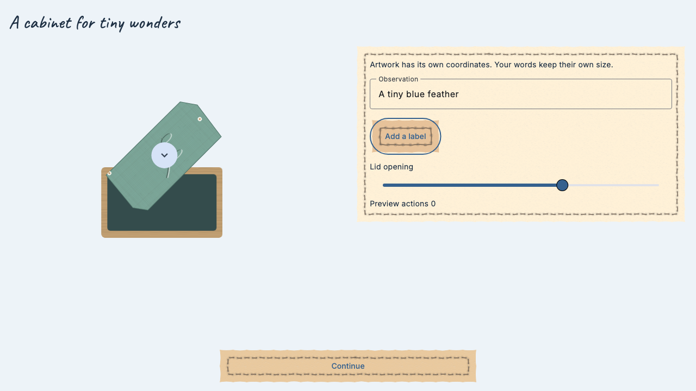
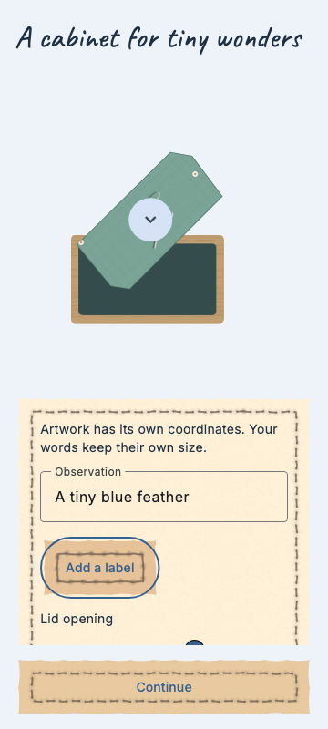

# An example-first experience frame

[Try the responsive frame](https://moisesaguiarjunior.github.io/handcrafted_flutter/?study=experience).

This is a runnable composition in `example/lib/experience_frame.dart` and
`experience_study.dart`, not a new package API or an application router. It uses
the original synthetic cabinet sprite already bundled with the example. No
consumer artwork, scene inventory, extraction manifest or product policy is added.





## Two coordinate spaces

The cabinet remains on its 400×400 authored artboard. `CraftImagePart` and
`PartPose` retain the source crop, hinge and pose. A native FittedBox applies one
contain fit, inside 24px of space reserved for a complete native target.

The lid button is outside that FittedBox. Its center comes from
`importedLidPart(...).mapSourcePoint(lidSourceRect.center)` and the same native
`applyBoxFit`/center destination used by FittedBox. Its 48px target stays native
at every image scale. It is an explicit button attached to a mapped image point;
it does not make every transparent/nontransparent image pixel interactive.
The underlying crop/pose adapter still uses one paint/input transform.

The heading, editable observation, choice, slider and Continue button are never
placed inside the artwork transform. They wrap and grow with the host's text
scaling. The body changes from columns to a row above 880px using the same Wrap
children, preserving field/focus state rather than exchanging layout subtrees.

```dart
// Under a Scaffold that owns keyboard resizing, in bounded viewport space:
ExperienceFrame(
  heading: yourNativeHeading,
  illustration: yourArtboardWithMappedNativeActions,
  content: yourNativeForm,
  footer: yourNativeAction,
);
```

`ExperienceFrame` and the synthetic factories are example-owned recipes. Your
application supplies its own widgets, palette, fonts, state, labels and persistence.
For raw image crops use public `CraftImagePart`; for themed native controls use
public `CraftPanel`, `CraftButton` and `CraftChoice`.

## Fixed footer, keyboard and safe areas

The native MultiChildLayoutDelegate measures the real footer once, then assigns
the rest to the body scroll view. No duplicate paragraph measurement, post-frame
size feedback loop or second responsive matrix is used. The footer stays at the
bottom when the body scrolls. It retains up to all space except a 96px body
reserve, or half the viewport when shorter than 192px. If its contents exceed
that allowance, the footer itself scrolls; labels are not shrunk or discarded.
This allows extreme keyboard/text constraints without reducing the body to zero.
A viewport too small to show multiple full controls still requires scrolling.

The host Scaffold must consume keyboard insets **once** with
`resizeToAvoidBottomInset: true`. The frame responds to its resulting constraints;
it does not subtract MediaQuery.viewInsets again. SafeArea consumes remaining
system padding. Native EditableText/Scrollable handling keeps the focused caret
reachable above the action area. The standalone frame test simulates keyboard
insets; this is not a physical-device keyboard certification.

The gallery gives this study a bounded body and omits its redundant large study
selector; its drawer and app bar remain available. Other studies keep their
existing layout. Do not nest this frame inside another unbounded vertical scroll.

## State, semantics and motion

All native labels exist before a visual reveal. Decorative imported pixels are
outside semantics and pointer handling; the separate native lid button supplies
its own tooltip/action. Native controls retain selection, focus, keyboard and
minimum-target behavior. The Continue action increments a transient preview
counter; it does not claim durable saving.

The illustration accepts caller-owned progress; this recipe has no art timer.
Reduced motion chooses the final initial pose. A deliberate slider or lid action
can still select a static pose. A host using timed motion should reuse its one
SceneEntrance/visibility policy; none is introduced by the frame.

## Reproduce and verify

From example/ run:

```sh
flutter test test/experience_frame_test.dart test/imported_layers_test.dart
flutter test --platform chrome test/experience_frame_test.dart
flutter test ../tool/capture_experience_frame.dart
```

The capture uses the licensed real fonts/icons and produces wide, narrow and
short/250%-text PNGs in `example/build/experience/`. This capture explicitly
settles ThemeData immediately, avoiding accidental capture of a font-theme
transition; it does not advance an artwork clock. Inspect before copying media.
No golden baseline is regenerated. Verification includes actual native taps at
mapped points, state/focus retention across reflow, footer stability while
scrolling, safe areas, explicit reduced-motion pose and simulated keyboard caret
visibility. Real device performance and consumer visual approval remain separate.
