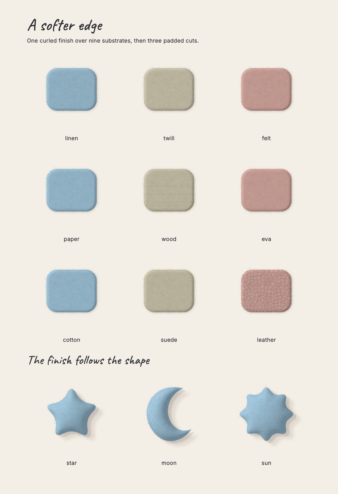

# A fluffy finish over any substrate

`CraftNap` is a prepared finish, independent of `CraftMaterial` and the body
profile. It can overlay paper, linen, twill, felt, wood, EVA, cotton, suede or
leather, including padded silhouettes. This is an optional decorative treatment;
it does not turn wood into physically simulated cloth or change existing tiles.

[Try Fluffy finishes](https://moisesaguiarjunior.github.io/handcrafted_flutter/?study=fluffy).



```dart
final nap = CraftNap(
  cut,
  scale: 1.25,
  density: 1,
  fiberLength: 3.5,
  curl: .65,
  edgeFuzz: .8,
  seed: 71,
);
// Reserve nap.paintBounds in the composition, independently of touch targets.
textures.paint(canvas, cut, material: material, color: clothColor);
nap.paint(canvas, ink: fiberShadow, highlight: fiberLight, contrast: .8);
volume.shade(canvas, localLight); // optional body lighting, clipped to the cut
```

## Independent controls

- `scale` (.5..4) controls candidate spacing and fiber width, as before.
- `fiberLength` (.25..6, default 1) changes length without changing spacing.
- `curl` (0..1, default 0) bends strands through three connected sections.
- `edgeFuzz` (0..1, default 0) adds short outward strands along closed contours.
- `density`, `direction`, `seed`, colors and contrast retain their contracts.

Defaults preserve the original random sequence and short-fiber pixels. Old
pillow, depth and plush images remain unchanged; no reference is regenerated to
make tests pass. The new capture is an independent study.

## Bounds, composition and ownership

The existing 320px-per-axis, coordinate, contour and total-path budgets apply.
Interior preparation allows at most 8,192 candidates. An enabled fringe adds at
most 4,096 contour candidates, checked before early returns for hidden density.
Each curled strand uses at most three quadratic sections; four tonal paths are
retained for the interior and at most four for fringe. No image, mesh, clock,
shader, global cache or offscreen layer is added by this finish.

`paintBounds` conservatively includes the possible fringe/stroke extent. Paint
outside the cut is opt-in and still respects ancestor/caller clips. Reserve that
margin without shrinking text or expanding touch/semantics automatically. On
holed cuts, strands may extend a short way into the hole; they do not fill its
interior. Thin details can have ambiguous outward directions at the probe scale.

This is a matte illustrative finish. Body lighting can shade the interior after
painting, but fringe is not a per-strand lighting/scattering model. No hair
physics, collision, textile stretch or mobile performance is claimed. Geometry
is prepared outside paint; changing only color/contrast does not rebuild it.
The example retains its volume when only fiber controls change.

Capture the actual Flutter specimens with
`cd example && flutter test tool/capture_fluffy.dart`. The native controls cover
all nine materials and a padded star; the capture also includes moon and sun.
Physical Android/iPhone profiling remains a separate task.
