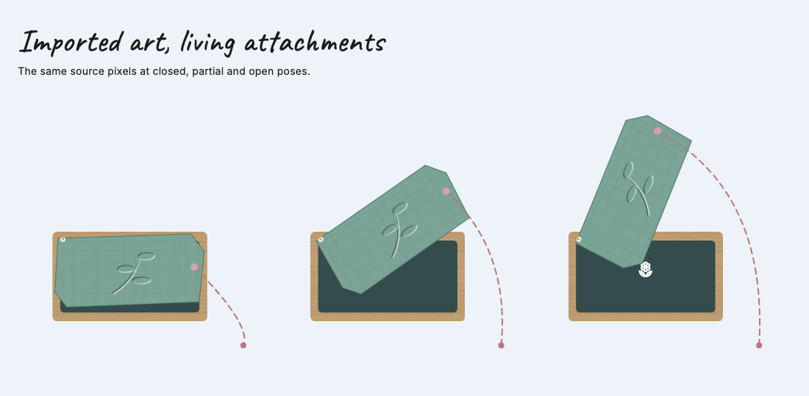

# Imported artwork with authored pivots

Run `flutter run -d chrome -t lib/main_scenes.dart` from `example/`.
The cabinet imports original synthetic PNG pixels; it does not redraw a
consumer's artwork. Its source authoring tool is included for provenance.



The example's `SourceLayer` records full source dimensions, crop rectangle and
hinge in source coordinates. Convert the hinge to normalized crop alignment
once. Convert attachments relative to that same crop using the effective layout
size, then map them with `PartPose.mapPoint`. Add the positioned layer's origin
after the pose. Do not subtract the crop origin twice or map against the full
sprite-sheet dimensions.

`ImportedComposition` calculates the effective art size from the available width.
Its `CraftPart`, mapped thread attachment and supplied hit silhouette share that
size and pose. Only artwork scales; the native content action retains a minimum
48-logical-pixel target. The parent reserves the complete movement envelope.
Applications must reserve their own envelope: painting outside a parent does not
make that area receive taps.

The lid uses a supplied polygon to exclude transparent corners from input.
This is authored shape testing, not automatic alpha-pixel testing. The source
image, supplied hit shape and attachment must agree. Layer order puts the lid
above the contents. The consumer defines a conservative reveal threshold; the
hidden content action is unmounted, removing focus and semantics as well as
pointer input. This example is a cabinet recipe, not general occlusion detection.

Progress is explicit, reversible and ticker-free. A native slider can scrub
closed, partial and settled poses; an external renderer can supply the same
values. No second clock, manifest format, navigation or persistence is added.
The example also works with reduced motion because it creates no automatic
movement; applications remain responsible for their playback policy.

Validation covers an authored hinge at two sizes, transformed taps and excluded
corners, mapped attachments, hidden action/focus/semantics, idle frames and
320-logical-pixel layouts with real fonts at 100%, 150%, 200% and 250% text.
This does not establish phone performance or browser runtime approval.

To reproduce the source sprite and reviewed capture separately:

```sh
flutter test tool/author_layer_asset.dart
cd example
flutter test ../tool/capture_imported_layers.dart
```

The capture is written to `example/build/scenes/`; inspect it before copying it
to `docs/assets/`. Ordinary checks do not regenerate assets or visual references.
