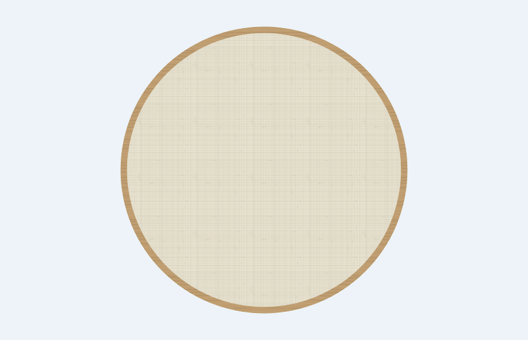

# Living paint and thread

Run the gallery with `flutter run -d chrome -t lib/main_gallery.dart` from example.
Choose Paint spreading or Embroidery in motion. Neither study starts an infinite
animation: play, pause, restart, finish or scrub to any explicit progress.

## Paint spreading

paintWatercolorSpread takes the same palette/seed/closed wash silhouette as
paintWatercolor, plus progress and an optional origin. It starts with an elongated
brush contact and direction-dependent front arrival times at 96 stations, rather
than scaling a circular mask. Grain remains anchored to the final silhouette;
cutouts remain untouched. At completion the result is exactly the static wash.
Validation precedes paint, including endpoints: 32 contours, 8192 arc units and
2048 pixels per axis, opacity/granulation/progress 0..1 and finite in-bounds origin.
There are four fringe strokes and one existing wash renderer; no blur, image,
clock, simulation grid or unbounded iteration. Same-renderer replay is stable.

The gallery separately explores a lifting brush, sixteen bounded deposits along
a moving brush, and blue over a pink base. Base wetness controls their authored
footprint and the extra violet exchange in the overlap. Dry layering preserves
the underlying wash through transparency. These are example recipes, not a
public fluid, spectral-mixing or measured-humidity API. The Canson distinction
between wet-on-dry glazing and flowing wet-on-wet paint informs the visual brief:
[Canson watercolor concepts](https://en.canson.com/expert-advice/basic-concepts-painting-watercolors).
No reference image or third-party rendering code is copied.

## Thread following the needle

Prepare with craftStitchPath, then sample CraftStitchFrame at progress 0..1.
The snapshot owns its geometry; changing the source or a returned path copy does
not change it. Frame.paint reuses the existing thread renderer. Its optional tip
provides position/direction for caller-owned needle art. At completion there is
no travelling tip; the final geometry and pixels match the static thread.

Prepared budgets are 3072 contours / 32768 arc units and finite bounds within
+/-8224. Actual generated anchors receive compression shading. A partial strand
has no false puncture at its moving endpoint. paintCraftStitch also accepts
progress; its default1 preserves existing rendering.

The original botanical example fills satin-like leaves with prepared strands.
Its thread alternates a visible drawing phase and a hidden return phase per
strand, without a needle icon. The default loose-thread study uses smooth seeded
wander, variable slack and fixed entry/exit anchors; below-cloth connectors are
never drawn. Each loop tightens to its final surface stitch. This is authored choreography, not physical thread/fabric displacement
or a simulation of the thread behind the cloth.

The separate embroidery-reveal mode retains the completed botanical use case:

## Ownership, accessibility and choreography

Painters accept explicit progress and retain no clock. The example reuses one
SceneEntrance; the host active flag pauses it, and route changes unmount it.
Background/TickerMode pause and reduced-motion settling reuse its existing
contract. Scroll visibility is supplied by the host, not automatically detected.
Native headings and descriptions exist at progress zero. The artwork is wrapped
in ExcludeSemantics/IgnorePointer; native controls own focus, selected state and
progress announcements. Scrubbing is an explicit user action under reduced motion.

For delayed sequences, compose the supplied progress with Flutter's existing
Interval, for example Interval(.2, .8).transform(progress). Use the same parent
clock for the following piece. No new timeline or timer is needed.

## Media

Explicit captures: `flutter test tool/capture_living.dart` and
`bash tool/encode_living.sh`. Inspect outputs before committing. PNGs/GIFs use
actual study widgets and synthetic original art; no golden baselines are changed.
GIFs show 49 supplied samples at 7fps once and hold the final pose. Use the
live controls to restart; no infinite GIF loop or continuously running solver
is introduced. Native-device cost remains unmeasured.
