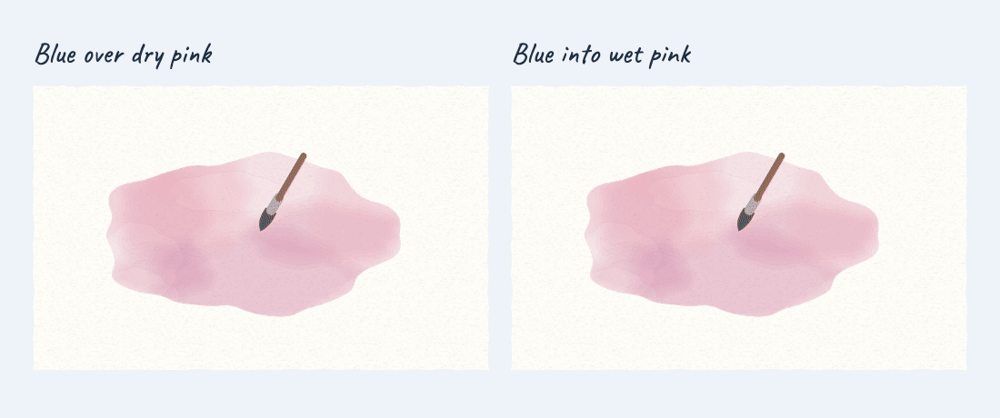
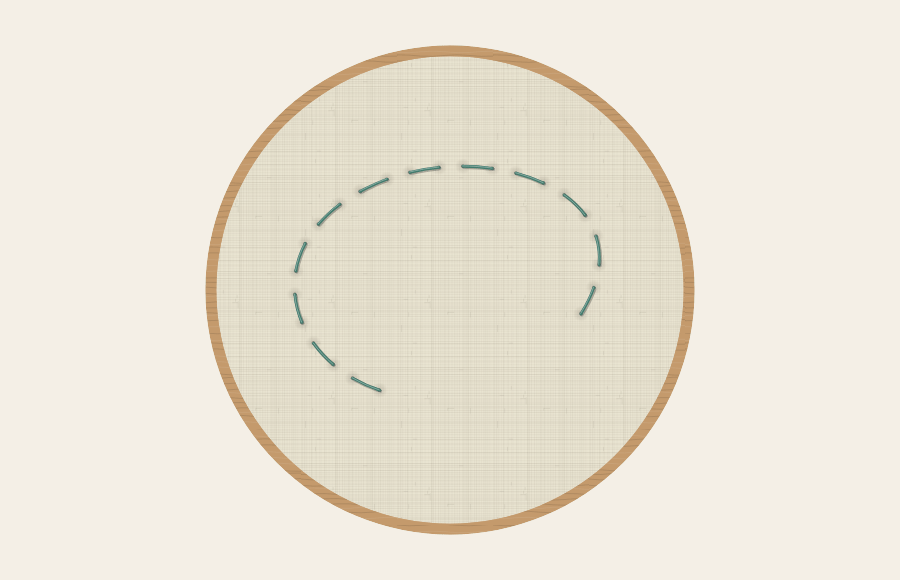
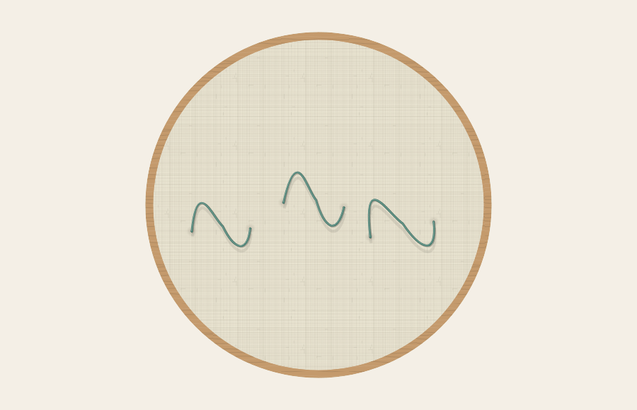

# Living paint and thread

Run the gallery with `flutter run -d chrome -t lib/main_gallery.dart` from example.
Choose Paint spreading or Embroidery in motion. Neither study starts an infinite
animation: play, pause, restart, finish or scrub to any explicit progress.

## Paint spreading

paintWatercolorSpread takes the same palette/seed/closed wash silhouette as
paintWatercolor, plus progress and an optional origin. It starts with an elongated
brush contact and direction-dependent front arrival times at 96 stations, rather
than scaling a circular mask. Grain remains anchored to the final silhouette;
cutouts remain untouched. At completion the result is exactly the static wash.
Validation precedes paint, including endpoints: 32 contours, 8192 arc units and
2048 pixels per axis, opacity/granulation/progress 0..1 and finite in-bounds origin.
There are four fringe strokes and one existing wash renderer; no blur, image,
clock, simulation grid or unbounded iteration. Same-renderer replay is stable.

The gallery separately explores a lifting brush, sixteen bounded deposits along
a moving brush, and blue over a pink base. Base wetness controls their authored
footprint and the extra violet exchange in the overlap. Dry layering preserves
the underlying wash through transparency. These are example recipes, not a
public fluid, spectral-mixing or measured-humidity API. The Canson distinction
between wet-on-dry glazing and flowing wet-on-wet paint informs the visual brief:
[Canson watercolor concepts](https://en.canson.com/expert-advice/basic-concepts-painting-watercolors).
No reference image or third-party rendering code is copied.



## Thread moving through the surface

Prepare with craftStitchPath, then sample CraftStitchFrame at progress 0..1.
The snapshot owns its geometry; changing the source or a returned path copy does
not change it. Frame.paint reuses the existing thread renderer. Its optional tip
provides position/direction for caller-owned tip artwork. At completion there is
no travelling tip; the final geometry and pixels match the static thread.

Prepared budgets are 3072 contours / 32768 arc units and finite bounds within
+/-8224. Actual generated anchors receive compression shading. A partial strand
has no false puncture at its moving endpoint. paintCraftStitch also accepts
progress; its default1 preserves existing rendering.

The gallery retains three distinct authored uses:

- **Finish stitches** starts with an existing seam and adds only the missing
  terminal stitches. A bare tip travels above the cloth, its irregular slack
  tightens, then the connecting transit stays hidden beneath the cloth. The
  example count is adjustable from 1 to 8, default 4; playback takes 600ms per
  missing stitch, so the default finishes in 2.4 seconds.
- **Thread passing** keeps the earlier loose-loop study: smooth seeded wander,
  variable slack and fixed entry/exit anchors. Below-cloth connectors are never
  drawn; each loop tightens to its final surface stitch. Playback is 3.6 seconds.
- **Embroidery reveal** keeps the full botanical sprig, now with 6-second
  playback. Its **Show loose thread** and **Show needle** switches independently
  control example artwork around the moving tip; the sewn result stays visible.
  Both props disappear during underside return phases and at completion. The
  needle is off by default.

These are example recipes, not new package presets or thread/fabric physics.
The package still supplies generated spans, owned snapshots and tip position;
applications own their art and visibility policy.



The previous loose-wave study remains available:



The separate embroidery reveal retains the completed botanical use case:


### Drive a reveal from scrolling

Use scroll position as the existing 0..1 input, rather than starting another
animation controller. The following adapter uses the public package painter;
`prepared` is caller-owned output from `craftStitchPath`. Keep native text and
controls outside the decorative paint, present from the first frame.

```dart
AnimatedBuilder(
  animation: scrollController,
  builder: (context, child) {
    // The host chooses an interval in its own scroll coordinates.
    final offset = scrollController.hasClients ? scrollController.offset : 0.0;
    final progress = MediaQuery.disableAnimationsOf(context)
        ? 1.0
        : ((offset - 120) / 320).clamp(0.0, 1.0);
    return ExcludeSemantics(
      child: IgnorePointer(
        child: CustomPaint(
          size: const Size(300, 180),
          painter: ScrollStitchPainter(prepared, progress),
        ),
      ),
    );
  },
);

class ScrollStitchPainter extends CustomPainter {
  ScrollStitchPainter(this.prepared, this.progress);
  final Path prepared; // Stable, caller-owned geometry; do not mutate in place.
  final double progress;
  @override
  void paint(Canvas canvas, Size size) {
    CraftStitchFrame.sample(prepared, progress: progress).paint(
      canvas, thread: const Color(0xFF427B6D), width: 2,
    );
  }
  @override
  bool shouldRepaint(ScrollStitchPainter old) =>
      old.prepared != prepared || old.progress != progress;
}
```

Scrolling back reverses the same deterministic reveal. This adapter has no
elapsed-time clock and no offscreen ticker to pause; the host still decides
which widgets to mount and the reveal interval. A host that uses timed playback
instead must keep supplying `SceneEntrance.active`. Optional loose strand and
needle artwork remains caller-owned, as in the runnable gallery recipe.

## Ownership, accessibility and choreography

Painters accept explicit progress and retain no clock. The example reuses one
SceneEntrance; the host active flag pauses it, and route changes unmount it.
Background/TickerMode pause and reduced-motion settling reuse its existing
contract. Scroll visibility is supplied by the host, not automatically detected.
Native headings and descriptions exist at progress zero. The artwork is wrapped
in ExcludeSemantics/IgnorePointer; native controls own focus, selected state and
progress announcements. Scrubbing is an explicit user action under reduced motion.

For delayed sequences, compose the supplied progress with Flutter's existing
Interval, for example Interval(.2, .8).transform(progress). Use the same parent
clock for the following piece. No new timeline or timer is needed.

## Media

Explicit captures: `flutter test tool/capture_living.dart` and
`bash tool/encode_living.sh`. Inspect outputs before committing. PNGs/GIFs use
actual study widgets and synthetic original art; no golden baselines are changed.
The finishing capture uses `flutter test tool/capture_thread_finishing.dart`,
then `bash tool/encode_thread_finishing.sh` (20fps, `-loop -1`). It shows
49 samples over approximately 2.4 seconds. The earlier GIFs retain 49 samples
at 7fps. All play once and hold the final pose. Use the
live controls to restart; no infinite GIF loop or continuously running solver
is introduced. Native-device cost remains unmeasured.
