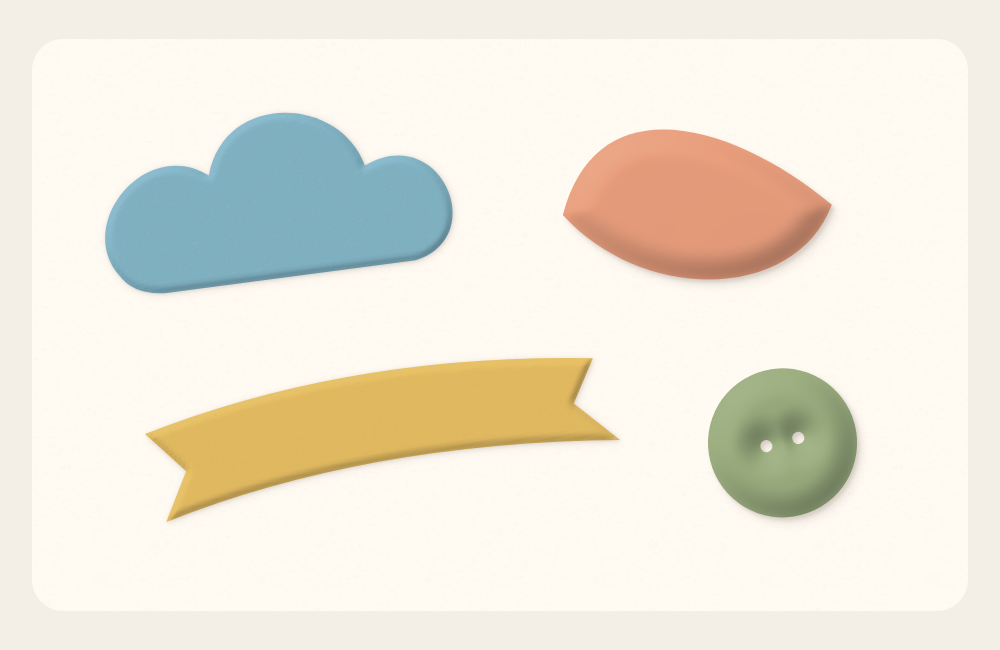
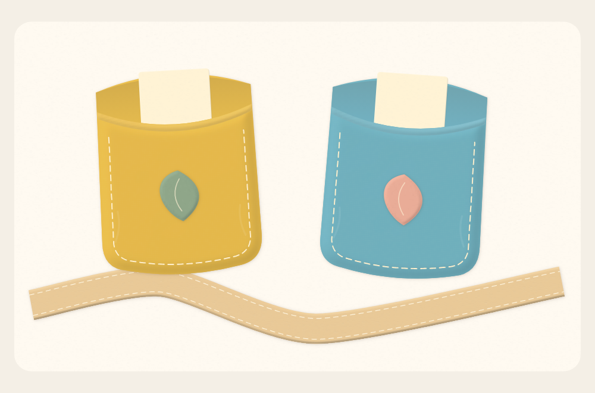
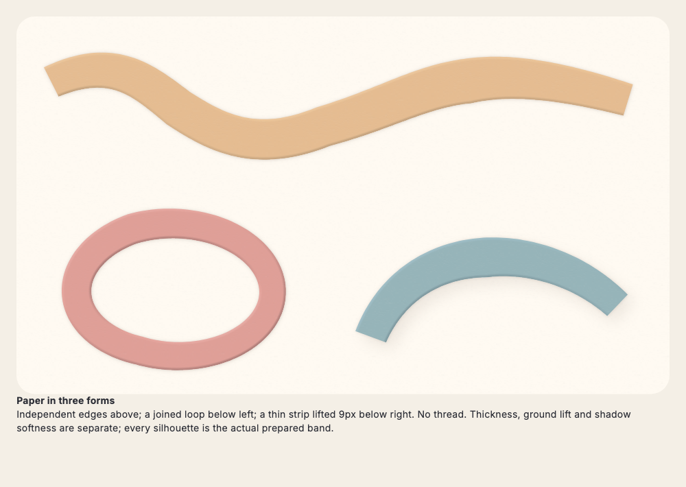

# Local volume, curved bands and a shared light

[Try the light controls](https://moisesaguiarjunior.github.io/handcrafted_flutter/?study=volume).
`CraftLight`, `CraftVolume` and `CraftBand` are bounded, caller-prepared painters.
The existing `paintCraftRelief` remains unchanged. Pocket construction and actor
silhouettes stay example recipes; no physical clay or cloth solver is exported.



Thin cut foam and a rounded clay-like profile are the first comparisons, not a
closed material vocabulary. Shape, base color, seeded grain, volume profile and
light are separate. A different grain or profile can reuse the same approach.
The mixed composition uses less grain on the rounded pieces; the controlled
comparison below deliberately uses identical grain to isolate the profile.


## Reuse before a new API

`MaterialTextures` paints the existing fine-pore EVA substrate. The original cuts
are prepared once by the `CraftVolume`; a distance-to-edge field
supplies a short bevel for the sheet and a wider roll for the rounded profile.
Small seeded depressions suggest pressure. They do not deform fabric or simulate
clay. Grid normals modulate the already painted grain through interpolated
vertex colors. Light changes reuse the geometry and normals.

The baseline calls the actual `paintCraftRelief`. It accepts planar direction
only; elevation, softness, warmth and ambient/directional weights affect the new
proof, not the baseline. Compare direction across all three; use the other
controls to examine the new profiles.

The example's contact and projected shadows are separate draws. Raising a piece
moves and softens its projected shadow. For the overlap specimen, the upper
piece's shadow clips to the lower receiver. A separate regression fixture
checks that receiver holes also stay untouched. There is no
scene-wide shadow map or general mutual-occlusion system.

## Using the recipe

The implementation is in `lib/src/craft_volume.dart`, with public exports from
`package:handcrafted_flutter/handcrafted_flutter.dart`. The example callers are
`volume_studies.dart`, `mixed_volume_study.dart` and `fabric_composition.dart`.
Prepare a closed cut outside paint, then paint an opaque substrate before shading:

```dart
final volume = CraftVolume(cut, CraftVolumeProfile.sheet, height: 3, bevel: 4);
final textures = MaterialTextures(seed: 71); // owner disposes this cache
final sceneLight = CraftLight(x: -.65, y: -.75, warmth: .4);

// In paint, after translating and rotating the piece's canvas:
final localLight = sceneLight.inLocalSpace(pieceRotation);
volume.shadow(canvas, localLight, receiver: localReceivingShape);
textures.paint(
  canvas, volume.outline,
  material: CraftMaterial.eva,
  color: const Color(0xFF83B7CC),
  strength: .3,
);
volume.shade(canvas, localLight);
```

The receiver uses the same local coordinate system as the cut. For scene-space
clipping, clip the receiving board before transforming the canvas, as the mixed
composition does. Convert incoming directional light by the inverse planar
rotation so that rotating a piece does not rotate the source. Translation does
not affect a directional light. This recipe assumes uniform scale and planar
rotation; perspective, shear and nonuniform normal transforms are not covered.

## Cost, limitations and ownership

- Closed cuts follow the existing 32-contour / 8192-length validation, then a
  stricter prepared-volume budget: at most 320 sampled segments, 320 pixels per axis and
  coordinates within +/-512. Sampling is at most 3 pixels along each contour.
- Preparation uses a 2-pixel grid, at most 26244 stations. Distance preparation
  visits stations and segments; keep it outside paint. Rounded height gets three
  fixed smoothing passes. Narrow features can lose volume or produce ridges;
  this is an approximate height field, not exact solid geometry.
- Each relight colors two shared-edge meshes, records them, and disposes their
  temporary native resources even if drawing throws. No texture, clock or global
  cache is created by the lighting recipe. Existing texture strength can use the
  material renderer's bounded transparency layer.
- Shading requires an **opaque substrate**. The modulate/screen composition does
  not preserve alpha for independently exported translucent cutouts. Do not use
  it as a transparent sprite renderer.
- Contact/projection and light softness are visual approximations. The light
  floor preserves color readability; this is not a radiometric or PBR model.
  Dents, surface grain and apparent height are not measured physical properties.
- No clock runs. The host changes light explicitly; a static light is already a
  reduced-motion result. Decorative painters are excluded from semantics and
  input. Labels and sliders stay native with enlarged text.

Capture actual widgets with `flutter test tool/capture_local_volume.dart`.
It writes the large comparison, mixed composition and 320/390-pixel strips into
`build/local-volume/`. Tests cover light direction/tint/interpolation, rotation,
receiver holes, lift, work limits, native controls and native-mesh disposal.
Desktop native and browser checks do not establish performance on a phone.

## Curved ribbon and pocket construction



`CraftBand(curve, width: 32, height: 2)` prepares one nonempty open centerline.
Paint its copied `outline` with MaterialTextures, then call `shade` with the same
CraftLight as neighboring pieces. `shadow` accepts a receiving cut and lift.
`rail(-11)` and `rail(11)` supply prepared parallel paths for existing stitches
or trim. `at(progress)` returns a point/tangent by arc length; it adds no clock.
Use `trimCraftPath(band.centerline, progress: progress)` for an explicit reveal.

A band supports width 4..96, apparent height .5..8 and sampling interval 1..6,
with at most 2048 intervals / 18441 cross-section vertices. Rails are sampled
normal offsets, not a polygon-offset guarantee. Keep bend radius above the inward-side distance (or conservatively the larger
side distance); self-crossings or very sharp corners can overlap. Flat end cuts are useful
for consumer-owned joins. The package does not place a bridge, route or doorstep.
Substrate painting still observes MaterialTextures' own 2048-axis limit; split
a larger scene into separately prepared cuts rather than raising a global guard.

The pocket example paints back, cavity, decorative note, front, small folds and
lip in that order. The front hides the inserted note; its pale irregular U seam
reuses inset relief at low compression, without a continuous dark outline. It
uses compact cotton grain and a small felt applique, not a new pocket texture.
The host supplies insertion0..1; final static progress is a reduced-motion result.
Native content stays outside the decorative painting and keeps its semantics.

CraftVolume accepts independent height .5..24 and bevel1..32. Both prepared types
return copies of paths; their mesh buffers remain private. Relighting uses one
shared mesh painter and shared contact/projection logic. Preparation is still
explicitly owned by the consumer, without a global cache or viewport detector.

## Independently shaped paper bands



Width keys are **distances on each side**, in logical pixels, at normalized arc
length. They interpolate linearly; supply seeded keys if an irregular edge is
wanted. The package reads no random global state. Every key is included in the
prepared stations, so the cut, edge rails, mesh and shadow share those widths.
The centerline controls the curvature; no sewing is added implicitly.

```dart
final band = CraftBand(curve, height: 1, widthProfile: const [
  CraftBandWidth(progress: 0, positive: 14, negative: 18),
  CraftBandWidth(progress: .5, positive: 24, negative: 13),
  CraftBandWidth(progress: 1, positive: 16, negative: 20),
]);
// Prepared before paint; use the returned outline for the substrate too.
final cut = band.outline;
final attachmentRail = band.edge(positive: false, inset: 3);
// In paint: shadow, opaque substrate using cut, then shade.
band.shadow(canvas, light, lift: 9, softness: 1.4);
```

An absent/empty `widthProfile` retains the original constant-width rendering.
`width` is the fallback width, not a multiplier for authored keys. Supply 2..128
strictly increasing keys with endpoints 0 and 1. Each side must be at least 2px,
their sum at most 96px. Their positions are copied into an immutable list.
The existing 2048-interval budget includes inserted key stations. Keys beyond
this budget fail during preparation, before any painting or native mesh creation.

`edge(positive: true/false, inset: ...)` follows each actual border. `rail(offset)`
remains an absolute normal offset and must fit the narrowest station on that
side. Positive is the canvas normal `(-tangent.dy, tangent.dx)`. Path getters
return copies. A single closed **smooth** centerline now produces a continuous
ring with an unpainted hole. Widths at 0 and 1 must agree on each side; the final
station reuses the first frame/normal. For an open band there are still flat caps.
Make a multi-curve join in one continuous source path to share its mesh; separate
band objects are not automatically welded. Sharp cusps, overlapping offset edges
and self-crossings are not solved. Keep bend radii larger than the local width
on the inside of the bend. Explicit input knots are not smoothed automatically.

`height` is apparent material thickness (.5..8), `shadow(... lift:)` is ground
separation (0..24), and `shadow(... softness:)` scales blur (.25..4). Changing
lift/softness does not rebuild or alter the shaded surface. This remains a
2D lighting approximation: the cut is not displaced by a physical simulation.
`CraftLight.softness` separately affects diffuse surface illumination. Defaults
preserve previous contact/projection shadows. The example keeps the note/pocket
recipe and adds three original unstitched paper cuts under the same light.
Captures include 320/390/428px layouts; these are desktop raster evidence, not
phone measurements.
