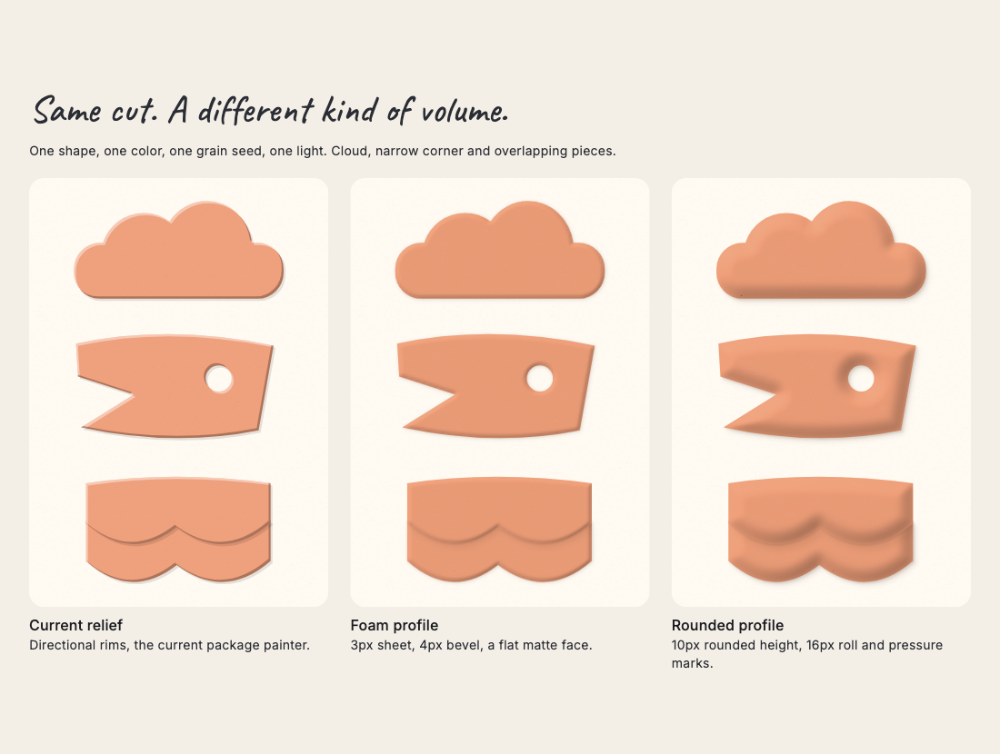

# Local volume and a shared light: an example experiment

[Try the light controls](https://moisesaguiarjunior.github.io/handcrafted_flutter/?study=volume).
This study is example-only. The package's existing `paintCraftRelief` remains
unchanged; no clay material, renderer or new public lighting API is exported.


Thin cut foam and a rounded clay-like profile are the first comparisons, not a
closed material vocabulary. Shape, base color, seeded grain, volume profile and
light are separate. A different grain or profile can reuse the same approach.
The mixed composition uses less grain on the rounded pieces; the controlled
comparison below deliberately uses identical grain to isolate the profile.



## Reuse before a new API

`MaterialTextures` paints the existing fine-pore EVA substrate. The original cuts
are prepared once by the example's `PreparedVolume`; a distance-to-edge field
supplies a short bevel for the sheet and a wider roll for the rounded profile.
Small seeded depressions suggest pressure. They do not deform fabric or simulate
clay. Grid normals modulate the already painted grain through interpolated
vertex colors. Light changes reuse the geometry and normals.

The baseline calls the actual `paintCraftRelief`. It accepts planar direction
only; elevation, softness, warmth and ambient/directional weights affect the new
proof, not the baseline. Compare direction across all three; use the other
controls to examine the new profiles.

The example's contact and projected shadows are separate draws. Raising a piece
moves and softens its projected shadow. For the overlap specimen, the upper
piece's shadow clips to the lower receiver, including its holes. There is no
scene-wide shadow map or general mutual-occlusion system.

## Using the recipe

The implementation is in `example/lib/local_volume.dart`, with callers in
`volume_studies.dart` and `mixed_volume_study.dart`. These are example imports,
not names exported by `package:handcrafted_flutter/handcrafted_flutter.dart`.
Prepare a closed cut outside paint, then paint an opaque substrate before shading:

```dart
final volume = PreparedVolume(cut, VolumeProfile.sheet);
final textures = MaterialTextures(seed: 71); // owner disposes this cache
final sceneLight = VolumeLight(x: -.65, y: -.75, warmth: .4);

// In paint, after translating and rotating the piece's canvas:
final localLight = sceneLight.inLocalSpace(pieceRotation);
volume.shadow(canvas, localLight, receiver: localReceivingShape);
textures.paint(
  canvas, volume.outline,
  material: CraftMaterial.eva,
  color: const Color(0xFF83B7CC),
  strength: .3,
);
volume.shade(canvas, localLight);
```

The receiver uses the same local coordinate system as the cut. For scene-space
clipping, clip the receiving board before transforming the canvas, as the mixed
composition does. Convert incoming directional light by the inverse planar
rotation so that rotating a piece does not rotate the source. Translation does
not affect a directional light. This recipe assumes uniform scale and planar
rotation; perspective, shear and nonuniform normal transforms are not covered.

## Cost, limitations and ownership

- Closed cuts follow the existing 32-contour / 8192-length validation, then a
  stricter example budget: at most 320 sampled segments, 320 pixels per axis and
  coordinates within +/-512. Sampling is at most 3 pixels along each contour.
- Preparation uses a 2-pixel grid, at most 26244 stations. Distance preparation
  visits stations and segments; keep it outside paint. Rounded height gets three
  fixed smoothing passes. Narrow features can lose volume or produce ridges;
  this is an approximate height field, not exact solid geometry.
- Each relight colors two shared-edge meshes, records them, and disposes their
  temporary native resources even if drawing throws. No texture, clock or global
  cache is created by the lighting recipe. Existing texture strength can use the
  material renderer's bounded transparency layer.
- Shading requires an **opaque substrate**. The modulate/screen composition does
  not preserve alpha for independently exported translucent cutouts. Do not use
  it as a transparent sprite renderer.
- Contact/projection and light softness are visual approximations. The light
  floor preserves color readability; this is not a radiometric or PBR model.
  Dents, surface grain and apparent height are not measured physical properties.
- No clock runs. The host changes light explicitly; a static light is already a
  reduced-motion result. Decorative painters are excluded from semantics and
  input. Labels and sliders stay native with enlarged text.

Capture actual widgets with `flutter test tool/capture_local_volume.dart`.
It writes the large comparison, mixed composition and 320/390-pixel strips into
`build/local-volume/`. Tests cover light direction/tint/interpolation, rotation,
receiver holes, lift, work limits, native controls and native-mesh disposal.
Desktop native and browser checks do not establish performance on a phone.
