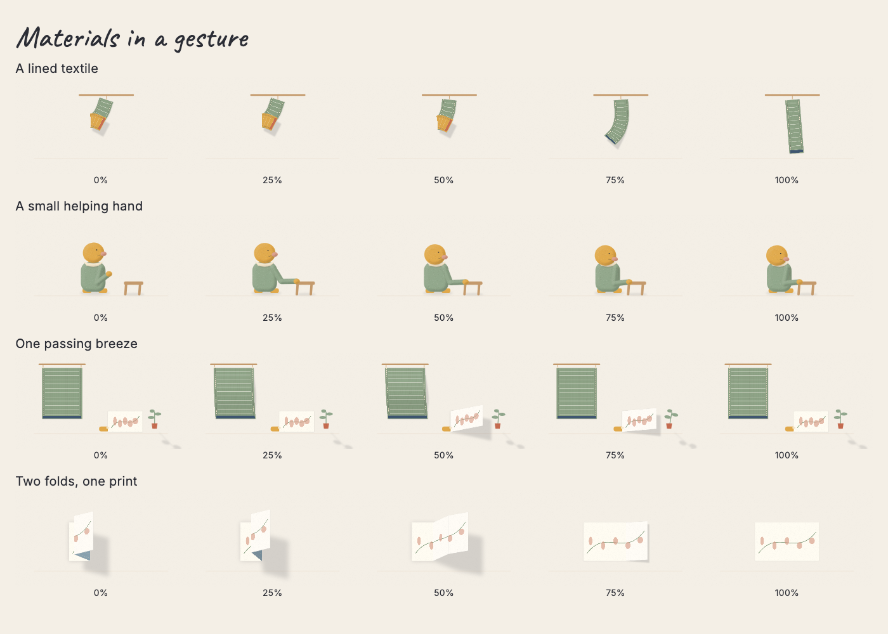

# Material gestures

Five requests are demonstrated as generic, example-owned recipes on the 0.4.0
API. The original [paper handoff](contact-and-cloth.md) remains at
`?study=contact`. Four further recipes are at
[Material gestures](https://moisesaguiarjunior.github.io/handcrafted_flutter/?study=gestures).
No private consumer scene, artwork, text, manifest or physics engine is included.



[Finite clip](assets/material-gestures.gif): the last pose is held; no repeated
playback is required. Scrub the live study in either direction. Its optional
clock is the existing `SceneEntrance`, explicitly paused by the host's `active`
flag and application lifecycle. Reduced motion selects the final pose. The host
must report offscreen visibility; the recipe does not detect scroll visibility.

## Reuse

Searched poses, contact mapping, fixed-source textile transport, light/volume,
nap, receiver shadows and finite controls. Existing `PartPose`, `CraftPart`,
`CraftVolume`, `CraftNap`, `MaterialTextures` and `SceneEntrance` supply those
contracts. The existing affine triangle calculation is extracted unchanged into
`material_patch.dart`, shared with the earlier planar strip. Native controls,
text, keyboard focus and text scaling remain in `ContactStudy`. Decorations are
excluded from semantics and input. The existing paper-transfer recipe is retained.

## Create

Only example code is added: bounded two-sided source transport, four original
material gestures and explanatory controls. The package API and dependencies
are unchanged. Source textures and fibers are prepared independently of time;
changing progress or light does not rerasterize the front/reverse prints. The
widget disposes its owned images on unmount and borrows no global cache.

| Request | Recipe and acceptance | Conclusion |
| --- | --- | --- |
| Paper handoff | Existing shared sheet/finger matrix, overlapping support, clear print area, parent rotation and out-of-order sampling | Existing composition; retained regression tests |
| Held textile | Two independently sized cuts, pinned shoulder, delayed cuff, visible lining, constant skin separation, height-derived ground shadow, stable rest | New example composition over existing primitives |
| Small soft figure | Tilted head, fixed-length two-link reach/pull, hand follows the stool's mapped grip; felt, linen and matte clay share one world light | New example composition; analytic articulation, no character API |
| One gust | Curtain, held note and plant sample one finite envelope with different lags; fixed rail/edge; geometry follows the print and its shadow | New example choreography; caller-sampled response curves accepted |
| Two paper folds | One persistent printed sheet, three panels/two hinges, reverse faces, constant thickness, depth ordering and height-derived shadow | New example composition; no arbitrary folding API |

## Run and reuse

Run `flutter run -d chrome -t lib/main_gallery.dart` inside `example`, then choose
**Material gestures**. The optional `initialRecipe` on `ContactStudy` chooses a
recipe while retaining its single finite clock. For an existing consumer clock:

```dart
MaterialStoryArtwork(
  recipe: MaterialRecipe.paper,
  progress: suppliedProgress, // 0..1, random access, no internal clock
)
```

These types live in `example/lib`, not the package export. Copy the small recipe
and its documented helpers when experimenting, or use its construction with
your own art. No new public surface-warp abstraction has been justified yet.
`AuthoredGust.responses` accepts already sampled curtain/note/plant curves from
an application; it does not own a ticker or run a solver.

## Geometry and limits

The shared source image is fixed at 2x. A source cell maps to two affine triangles;
front, reverse, thickness walls and material-point guides use the same corners.
Positive z is height above the receiving board. The oblique projection is
`(x, y - .45z)`; a directional light projects ground shadows from those heights.
Canonical `CraftVolume` shading supplies the face response, with its direction
converted into the local normal frame. Each source cell's prepared flat shader
extends beyond its crop to avoid drawing a separate bevel at every internal row.

Cloth uses 32 cells, the curtain 24 and paper three. Source dimensions are at most
320 per axis; these authored worlds stay inside the board. The recipes have no
integration history. Cloth is a compressible authored strip, not an isometric
fabric or a physical simulation. Its lateral rails remain continuous, including
at changes of face. It does not model fabric memory, collisions or mutual
self-shadowing. Folded paper uses nonintersecting authored panels and depth-sorted
triangles, not a general z-buffer; arbitrary intersecting meshes are unsupported.
The paper's material midline shares both hinges; its skins have a fixed .8-unit
separation and the cut walls seal the ends.

The soft figure's two arm lengths are fixed. The stool moves only after the
reach; its grip is the hand target during the pull. The nose uses the head matrix,
and contact shadows are clipped into their parent cuts. Felt uses prepared
seeded nap, linen a thin woven profile, clay a rounded low-grain profile; clay is
a visual finish, not a new substrate enum. The original face and limbs are a
construction specimen, not a reusable character identity.

The gust is authored, finite and nonperiodic. The note's left edge is held while
its free edge rises. The plant's same rotated cut projects its shadow using
height inferred from its upright silhouette. This is an illustrative upright
plant projection, not arbitrary scene reconstruction. No camera movement is
needed to demonstrate the response. The optional whole-board rotation transforms
all contacts and shadows together; it rotates the presentation, not the world lamp.

## Evidence

`example/test/material_gestures_test.dart` exercises both cloth cuts and paper
at 101 samples, thickness/hinges, real reverse-color pixels, opaque open creases,
arm contact and lengths, wind lags/supports, out-of-order raster identity,
material differences, image lifetime and native controls at 250% text.
Earlier contact/continuous tests remain the regression baseline. Captures use
actual Flutter rendering, not generated bitmap substitutes:

```sh
flutter test tool/capture_material_gestures.dart
bash tool/encode_material_gestures.sh
```

The montage samples 0, .25, .5, .75 and 1. Phone-sized captures are under `build/`;
those are desktop raster proofs, not phone performance measurements. Physical
Android/iPhone timing, memory and visual validation remain deferred. Consumer
art direction and adoption are separate from completion of these generic proofs.
