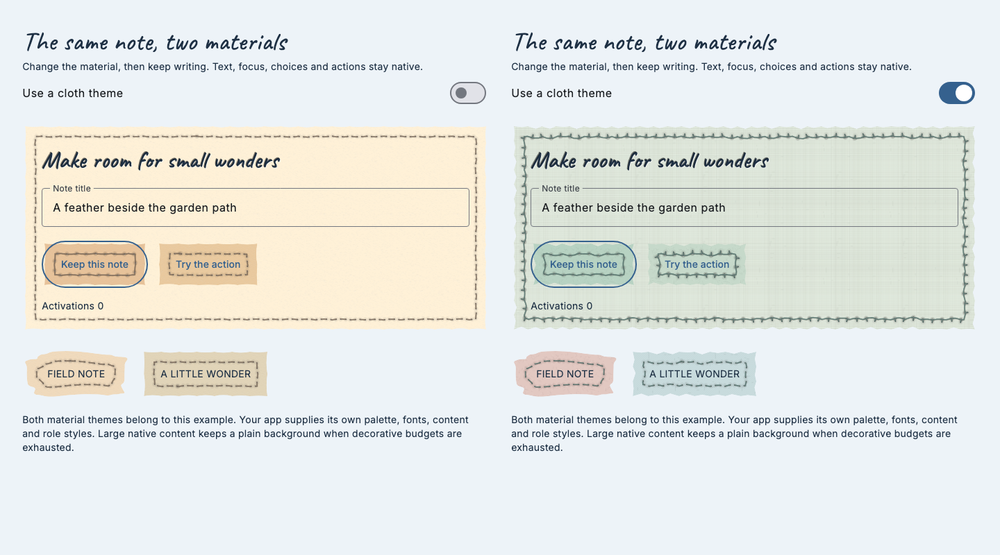

# Host-themed material components

Install `CraftTheme` in `ThemeData.extensions`, or give a component an explicit
`CraftPanelStyle`. The package supplies no color palette, fonts, illustrations,
content or application state. The live example supplies separate paper and cloth
recipes over the same native controls.



[Try the material vocabulary](https://moisesaguiarjunior.github.io/handcrafted_flutter/?study=vocabulary).

```dart
final materials = CraftTheme(
  surface: CraftPanelStyle(
    material: CraftMaterial.paper,
    color: paperColor, // supplied by your application
    shape: const CraftOutline.paper(edge: PaperEdge.deckle, edgePitch: 24),
    seam: CraftSeam(color: threadColor),
  ),
  roles: {
    CraftRole.selectedChoice: CraftPanelStyle(
      material: CraftMaterial.felt,
      color: selectedColor,
      seam: CraftSeam(color: threadColor, kind: CraftStitchKind.blanket),
    ),
  },
);

// Add materials to ThemeData.extensions alongside your other extensions.
CraftPanel(
  role: CraftRole.card,
  child: Column(
    crossAxisAlignment: CrossAxisAlignment.start,
    children: [
      TextField(controller: titleController),
      CraftChoice(
        selected: selected,
        onSelected: (value) => setState(() => selected = value),
        child: const Text('Keep this note'),
      ),
      CraftButton(onPressed: save, child: const Text('Save note')),
    ],
  ),
);
```

`CraftRole` names sheet, card, tag, ribbon, tray, button and unselected/selected
choices. Roles select styles, not application layouts or authored art. Missing
roles use the theme's `surface`. Explicit component styles need no CraftTheme.
This is the first foundation slice: native relief text already exists as
`CraftReliefText`; further heading/finish recipes and an experience frame remain
separate work. A role name does not add a complete tray, ribbon control or scene.

## Native interaction and identity

- Native content determines size. No font or label is shrunk to fit a cut.
- Decorative material/thread has no semantics or pointer handling. It does not
  clip the native content. `CraftSurface` remains available when clipping content
  and input to a silhouette is actually intended.
- `CraftButton` uses native TextButton/Material/InkWell over the decoration, so
  hover, focus, pressed feedback and keyboard activation remain native. It keeps
  a 48-by-48 minimum target despite compact button themes; parents must allow it.
  The target is rectangular, including transparent corners of the decorative cut.
- `CraftChoice` keeps a native selected outline even without role overrides,
  so selection is visible beyond a color change. It is controlled by the host.
  Selected state and activation share
  the same merged semantics node, including a disabled-but-selected choice.
- Replacing CraftTheme updates decoration without replacing the child subtree.
  Keep keys stable; do not key a form by palette name. Applications still own
  focus nodes, text controllers and durable saving.

Color contrast, text styles and disabled foregrounds belong to the application's
native theme. The gallery uses fictional content and a transient activation
counter; it does not demonstrate persistence.

## Bounds and resource ownership

CraftPanelStyle and CraftSeam validate numeric inputs before rendering, including
non-finite values, directional padding and value-contour parameters. Component
seams use pitch 8..48, transverse depth 1..8, inset 0..64, width .5..4 and
compression 0..1. The inset is nominal and polygonally approximated at 2px sample
spacing. Thread/shading is clipped to the decorative cut; reserve more clearance
when using wide thread. Lower-level painters retain their existing wider budgets.

Geometry is prepared outside paint and retained by effective size, contour,
inset and stitch recipe. Material tile lifetime remains with the existing
CraftSurface owner; there is no global cache or new clock. Colors do not replace
prepared geometry. Changing the seed replaces the texture owner as before.

Above 1024 logical pixels on either axis, or when contour/thread preparation
exhausts existing work budgets, decoration becomes a plain host-colored fill.
Native content and its state remain. This component budget is deliberately
smaller than the raw 2048-axis material-painter budget; no renderer limits are
relaxed. Invalid recipes still throw, rather than being hidden by a fallback.

Theme transitions interpolate base colors and native padding. Substrate, cut,
seed, grain and thread recipes switch at the midpoint; no physical transition is
implied. Foreground/native styles continue to come from the host ThemeData.

Run `flutter test tool/capture_vocabulary.dart` to reproduce the actual-widget
image. No golden baselines are regenerated. Native/browser behavior tests do not
establish phone performance or consumer visual approval.
