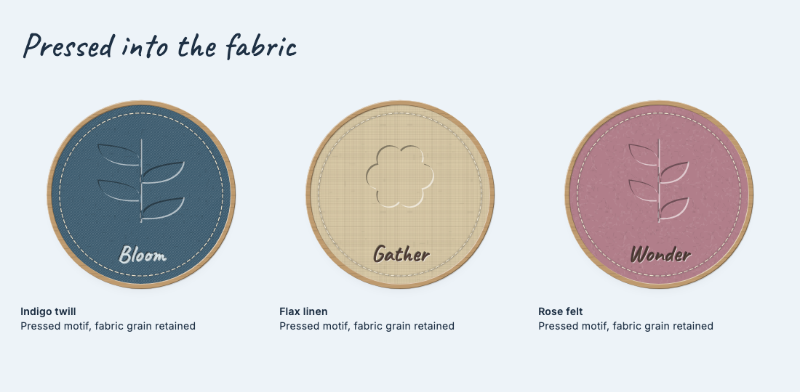
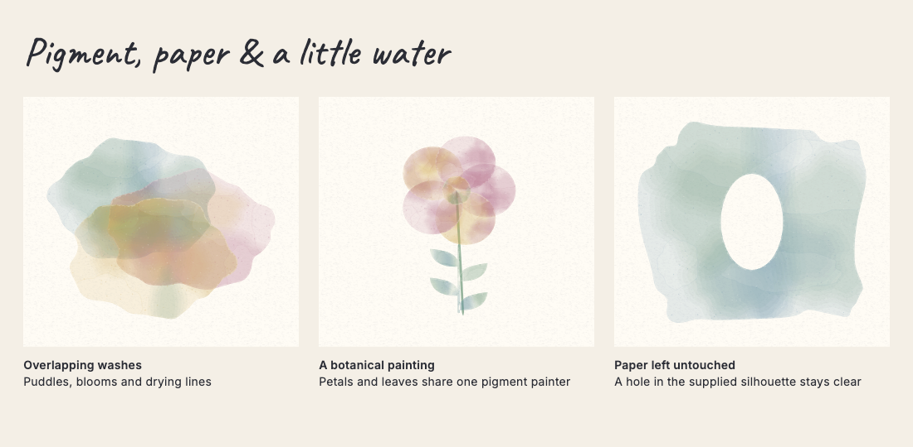
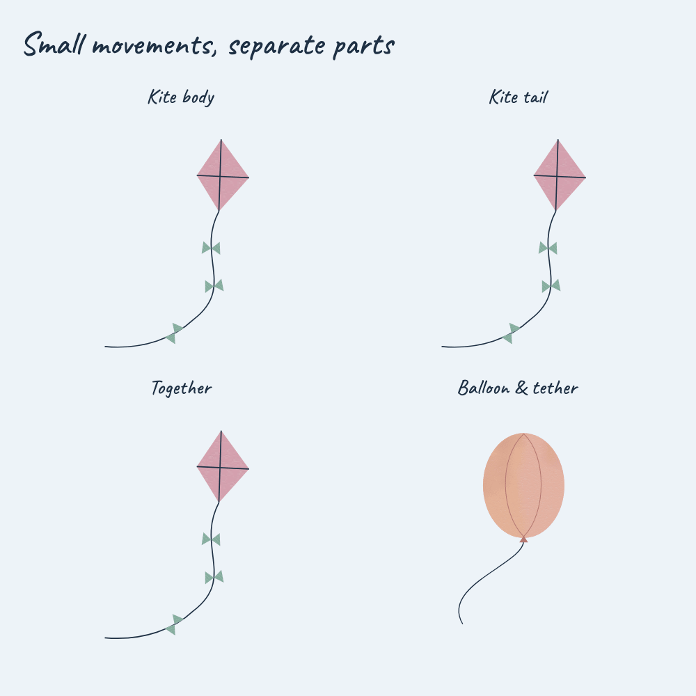

# Materials, impressions, pigment and motion

Run the complete gallery from `example/`:

```sh
flutter run -d chrome -t lib/main_gallery.dart
```

All specimens are synthetic Flutter compositions. The same widgets produce the
live gallery, PNGs and sampled motion GIF. No consumer artwork or screenshots
are included. Source: [material studies](../example/lib/material_studies.dart),
[motion studies](../example/lib/motion_studies.dart) and
[shared kite art](../example/lib/kite_art.dart).

## What exists today

| Area | Package API | Example coverage |
| --- | --- | --- |
| Five texture algorithms | `CraftMaterial`, `MaterialTextures`, `CraftSurface` | Indigo twill, flax linen, rose felt, drawing paper and wood |
| Silhouettes | `pigmentOutline`, `CraftOutline` | Organic swatches, native-widget surfaces and circular fabric specimens |
| Paper recipes | `paperOutline`, `CraftOutline.paper`, `paintPaperFinish`, `paintPaperEdgeFibers` | Six visual stocks, four edges and native letterhead; existing base grain is reused |
| Sewing | `insetCraftPath`, `craftStitchPath`, `paintCraftStitch` | Six surface patterns, polygonal contour-following seams and puncture shading |
| Drawing | `craftCurveThrough`, `trimCraftPath`, `paintCraftStroke` | Continuous, dotted or dashed pen/marker/brush/pencil/chalk/wax lines and explicit reveal |
| Watercolor | `paintWatercolor` | Overlapping washes, a botanical painting and a resist/cutout study |
| Relief | `paintCraftRelief`, `CraftReliefText` | Pressed/raised botanical motifs, reversible light and native lettering |
| Motion | `PartPose`, `CraftPart`, `SceneEntrance` | Body sway, local tail deformation, both together, balloon/tether and hanging pieces |
| Imported image | `CraftImagePart` | One public crop/hinge/artboard adapter with native overlay, source mask and attachment mapping |

Colored twill and linen specimens are recipes of existing algorithms, not new
denim/cotton material implementations. Motion actors are runnable examples;
the package does not ship a general actor system. A separate bounded rigid
pendulum samples constant gravity/wind; flexible rope/cloth remains future work.

## Fabric and impressions



The motifs are original botanical drawings. Cloth is still visible inside the
impressions. The circular running stitch reserves enough room for thread and
puncture shading. Other closed silhouettes can use the bounded polygonal
[contour inset](contour-seams.md); it approximates curves and may split islands.

```dart
paintCraftRelief(canvas, motif,
  kind: CraftReliefKind.inset,
  depth: 2.5,
  light: const Offset(-1, -1),
);

CraftReliefText('Field notes',
  style: const TextStyle(fontSize: 28, color: Color(0xFF36566A)),
)
```

Without a `fill`, motif interiors retain the underlying substrate. Raised rims
add a short contact shadow; inset rims stay inside the supplied closed shape.
Both respect holes. `depth` is 0..8 logical pixels and `strength` is 0..1.
These directional stencils illustrate relief without displacing fibers.

Lettering stays a real Text widget. Its inner shading borrows the native
paragraph's resolved span, alignment, spacing, scaling, ellipsis and direction.
It does not maintain a second interpretation of application text layout.
Native shadows remain when the paragraph paints a background, exceeds 2048
logical pixels on either axis, or exceeds 1,048,576 square logical pixels.
The glyph effect uses offscreen layers; native-device performance is unmeasured.

## Watercolor



```dart
paintWatercolor(canvas, silhouette,
  pigment: const Color(0xFF648FA9),
  companion: const Color(0xFF6A9577),
  paper: const Color(0xFFFFFCF5),
  seed: 23,
  opacity: .7,
  granulation: .8,
);
```

Compose paper grain first with CraftSurface or MaterialTextures. Supply its base
color as `paper` so blooms/pores expose the intended substrate. Independent
puddles, pale backruns, tide marks and deposits approximate pigment on paper.
Zero opacity paints nothing. The exact supplied silhouette and its holes clip
every layer; no capillary approximation silently replaces the clipping shape.
No diffusion, drying-time simulation or external texture is involved.

Closed paths are required. Opacity/granulation are 0..1; bounds are at most 2048
logical pixels per axis, with the existing 32-contour / 8192-length work limits.
Changing a seed or palette is explicit; no frame or wall clock changes the grain.

## Independent motion



The capture uses original example-owned geometry and supplied progress.

The body example moves a parent CraftPart, carrying the attached tail rigidly.
The tail-only example holds the sail still and deforms the local ribbon. The
combined example supplies both progress values independently. The balloon's
string begins at its knot mapped through the same body PartPose used for paint.

```dart
// Example widget, not an additional core package API.
MotionSample(
  subject: MotionSubject.kite,
  bodyProgress: bodyTime,
  detailProgress: tailTime,
)
```

The live Motion page has separate sliders and enables each movement separately.
Play uses the existing finite SceneEntrance clock; Still pose settles it. Manual
scrubbing creates no second clock. Automatic playback respects reduced motion;
inactive body/detail channels do not keep it ticking. Leaving the Motion section
unmounts its clock. Viewport scrolling still requires the host's activity policy.
An external renderer can supply explicit progress without mounting a live clock.

Body/tail/tether movement is authored, not wind, buoyancy, cloth or rope physics.
Bird, water/ripples, a physical crib mobile and catenary constraints remain planned.

## Capture and validation

```sh
flutter test tool/capture_atlas.dart
bash tool/encode_atlas.sh
```

Static sheets are 1100x850 (materials) and 1100x540 (impressions/watercolor).
Motion uses 49 explicit poses, 1000x1000, encoded at 12 fps with a 128-color
palette. Pixel ratio is 1 with the bundled licensed Inter/Caveat fonts. GIFs loop
to replay a finite movement; live playback stops. Capture encoding does not
measure frame rate or phone performance. Ordinary tests do not regenerate media
or golden baselines. Inspect results before copying them to docs/assets.

Tests cover seeded wash changes, clipping/holes, zero opacity, relief/light
direction, invalid-input side effects, native lettering layout and semantics,
centered glyph alignment, independent body/tail pixels, reduced motion and all
gallery sections at 320 logical pixels with real-font scaling up to 250%.
See [roadmap](roadmap.md) for remaining work rather than treating images as a
promise of unimplemented material families or physical behavior.
