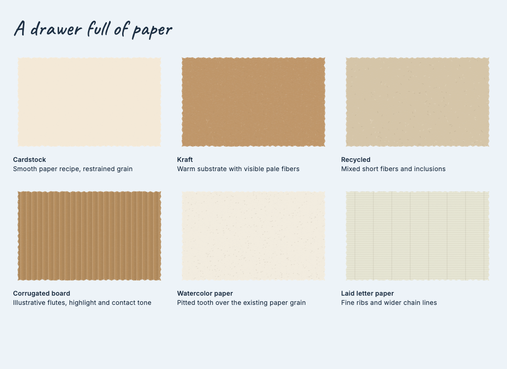
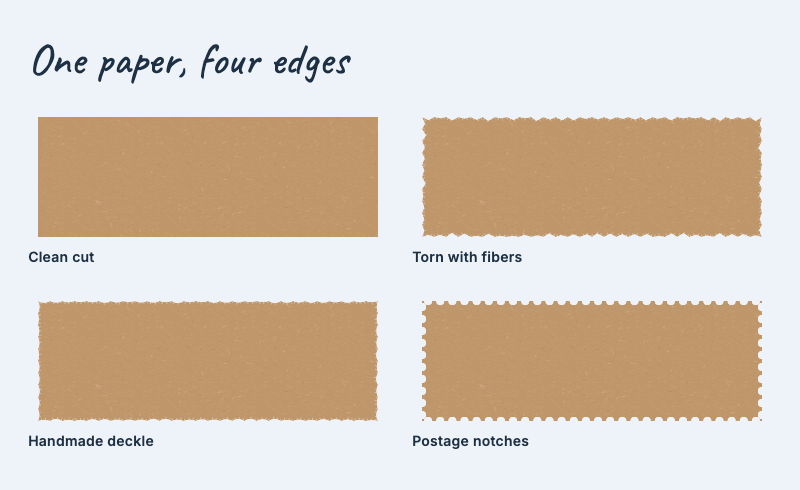

# Paper stock, edge and finish recipes

Run `flutter run -d chrome -t lib/main_papers.dart` from `example/`.



These are six visual recipes, not six additional texture-cache algorithms:

| Recipe | Substrate | Additional finish |
| --- | --- | --- |
| Cardstock | Warm paper, low grain strength | None; smoothness is restrained existing grain |
| Kraft | Brown paper | Pale/dark short fibers at lower strength |
| Recycled | Warm neutral paper | Mixed short fibers and inclusions |
| Corrugated board | Brown paper | Directional flutes, highlight and contact tone |
| Watercolor paper | Pale paper | Small irregular pits suggesting cold-pressed tooth |
| Laid letter paper | Pale paper | Fine laid ribs and wider chain lines |

`MaterialTextures` still owns five base texture algorithms. `paintPaperFinish`
adds marks without replacing their fill/grain. Color, strength, scale and seed
are explicit; no image, global cache or timer is created. Recycled/coldPress use
at most 900 seeded marks; laid/corrugated use bounded directional patterns (up
to 2200 strokes). Laid and corrugated patterns do not depend on seed. Strength
is 0..1 and scale 0.5..4; shapes must be closed, up to 2048 logical pixels per
axis and within shared contour/length limits. Ink and highlight alpha are
respected. Zero strength leaves the substrate unchanged. Every mark clips to
the supplied shape, including holes.

```dart
final outline = paperOutline(bounds, edge: PaperEdge.torn, seed: 23);
textures.paint(canvas, outline,
  material: CraftMaterial.paper, color: paperColor, strength: .55);
paintPaperFinish(canvas, outline,
  finish: PaperFinish.recycled, ink: fiberInk, highlight: paleFiber,
  seed: 23, strength: .7);
paintPaperEdgeFibers(canvas, outline, fiber: paleFiber, seed: 23);
```

## Four independent edge treatments



`paperOutline` creates clean, torn, deckle or postage silhouettes. Use the same
value recipe through native-widget surfaces:

```dart
CraftSurface(
  material: CraftMaterial.paper,
  color: paperColor,
  shape: const CraftOutline.paper(
    edge: PaperEdge.postage, edgeDepth: 3, edgePitch: 12,
  ),
  child: TextButton(onPressed: selectPaper, child: const Text('Use this paper')),
)
```

Edges stay within the supplied rectangle. Torn edges are seeded/angular; deckle
edges use seeded soft waves; postage uses regular inward semicircular notches.
Seed affects torn/deckle only. Depth is maximum inward intrusion, not a constant
offset; deckle curves need not attain it. Depth is 0..12 and at most pitch/3;
pitch is 8..64. Zero depth/clean cut returns a rectangle. Empty or insufficient
corner room (depth * 3 greater than the narrower dimension) yields no silhouette.
Negative dimensions, nonfinite values, bounds above 2048 per axis, coordinates
outside +/-8192, over 1024 edge periods or exceeded shared path limits throw.

Fibers are a separate clipped fringe, not part of the silhouette or simulated
fiber displacement. `paintPaperEdgeFibers` uses length 0..4, strength 0..1 and
bounded short strokes. Use it selectively for torn/handmade paper; color comes
from the host. Geometry, base grain and finish seeds may be controlled separately.

## Native letterhead and external renderers

Letterhead is composition, not a material algorithm. The example prints real
text and a native action over paper. At 150% text and above, it omits decorative
sewing while retaining the same action element and paper edges. It does not
scale labels down to fit an illustration. The example-local outline cache is
shared with seam studies; equivalent recipe/size retains geometry and a changed
edge invalidates it.

An external Fluvie frame or Social Studio template can pass fixed edge, finish,
palette, strength, scale and seed arguments. These functions read no time. Keep
the serialized schema in the consumer and validate enum names/ranges there;
the package does not impose a template/manifest format. Progress remains a
separate input for any moving parent part. See [integration contracts](integration.md).

These are illustrative recipes. Corrugation does not add physical thickness;
watercolor tooth does not simulate wet paint. Tissue, tracing-paper transmission,
additional stock structures, marks and mechanical behavior remain roadmap work.
Native-device performance is unmeasured. Use the rendering harness before adding
shared finish/texture caches.

Tests cover distinct/seeded finishes, holes, zero strength, clipped fibers, edge
bounds/notches, work/range validation, value-based surface invalidation, native
actions and 320px text through 250%. Capture is explicit and uses the actual
example widgets:

```sh
flutter test tool/capture_papers.dart
```

Inspect `build/papers/` before copying images into docs/assets. Existing seam and
card captures stay unchanged by the shared example-cache extraction.
