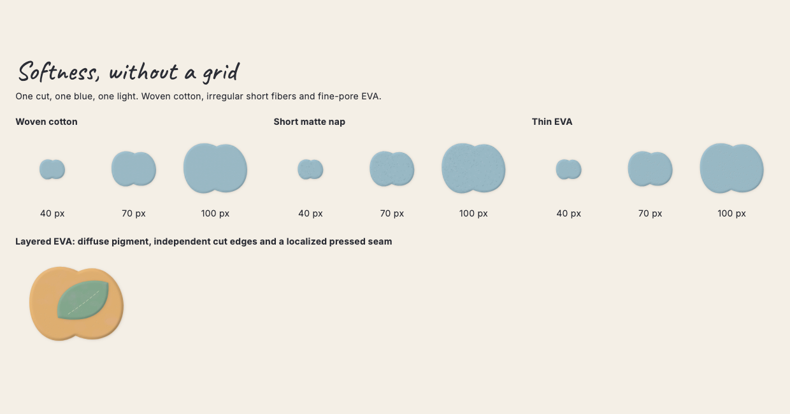

# Short matte fibers and layered foam



[Try Cloth, chalk & folds](https://moisesaguiarjunior.github.io/handcrafted_flutter/?study=softCraft).
The comparison uses one original cut, blue, directional light and thin profile.
The 40/70/100 labels name **logical artboard widths**, not magnified pixels or
measured fiber sizes. Thin EVA and woven cotton use existing MaterialTextures
at strength .65; the new nap is a finish over a flat blue substrate. Appearance
is intentionally distinct, not calibrated physical roughness.

## A finish, separate from the material and cut

`CraftNap` prepares short irregular curved fibers outside paint. It complements
fixed `CraftMaterial.cotton`/`suede` tiles: neither existing tile nor enum changes.
There is no new material cache, raster tile or texture ownership contract.
The owner keeps the prepared nap until its cut, scale, density, direction or seed
changes. Colors and contrast are paint-only; relighting does not prepare fibers.

```dart
final nap = CraftNap(cut, scale: 1, density: .7, direction: -.4, seed: 71);
final volume = CraftVolume(cut, CraftVolumeProfile.sheet, height: 1.5, bevel: 2);
// In paint: shadow, caller's substrate, fiber finish, then volume lighting.
canvas.drawPath(cut, Paint()..color = const Color(0xFF9CBFD0));
nap.paint(canvas, ink: const Color(0xFF344F62), contrast: .8);
volume.shade(canvas, light);
```

Scale (.5..4) controls fiber length, stroke width and candidate packing.
Density (0..1) admits a fraction of the same seeded candidates. A few broad
seeded density clusters break uniform coverage; no regular weave is added.
Direction is the mean angle in radians, with independent per-fiber variation.
Contrast (0..1) controls translucent ink/highlight strength; zero paints nothing.
The four tonal paths are recorded during preparation and replayed with four
stroke draws under one clip. This suggests soft nap, without specular sheen,
fiber displacement, silhouette fuzz, translucency or a cloth simulation.

One finite closed cut may include holes. It follows the existing 32-contour /
8192-length contract, with bounds <=320 per axis and coordinates within +/-8192.
The candidate budget is `ceil(bounds.width * bounds.height / scale² * .18)`,
at most8192, checked before fiber sampling even for zero density. Larger cuts
or very fine packing can require a coarser scale; the full .5..4 /0..1 controls
are supported for the documented <=100px artboards. Work is bounded by the
bounding rectangle, not only filled area. There is no silent density clamp.

All four paths and the cut are private; `outline` returns a copy. Fibers are
stored in local coordinates and translated with the cut. Identical inputs on the
same renderer are deterministic. Resource ownership stays with the existing
substrate cache; nap has no disposable image/vertices/layer or timer. Batching
limits draw calls, but does not establish throughput or memory cost on phones.

## EVA over EVA

The original example badge composes two independent `CraftVolume` cuts under
one `CraftLight`, each with its own height/bevel and fine-pore substrate. Existing
`FoamFinish.mottled` adds broad low-contrast pigment variation, independently of
pores. The upper shadow passes `receiver: base.outline`, so it does not darken
outside the receiving cut. A prepared short inset seam stays localized inside
the upper shape; it is not a dotted finish across the whole material.

Paint order is lower shadow/substrate/pigment/shading, upper receiver-clipped
shadow/substrate/pigment/shading, then localized sewing. The receiving cut uses
piece-local coordinates; a shared directional light does not provide scene-wide
shadow maps or mutual occlusion. The example does not export a badge preset.

## Actual samples and checks

`flutter test tool/capture_nap.dart` captures the same widgets as the gallery to
`build/nap/`, including 320/390/428px layouts. Native sliders retain their labels,
adjustment actions and enlarged text. Contrast updates retain prepared nap;
geometry inputs replace it. Leaving the study disposes the existing textures.

Tests verify changed deposits for each parameter, stable seeds, path-copy safety,
translation, empty endpoints, hole/edge clipping, work limits and native controls.
These are native/browser raster and widget checks. Android/iPhone measurements
and tactile fidelity to any particular fabric remain separate evidence tasks.
