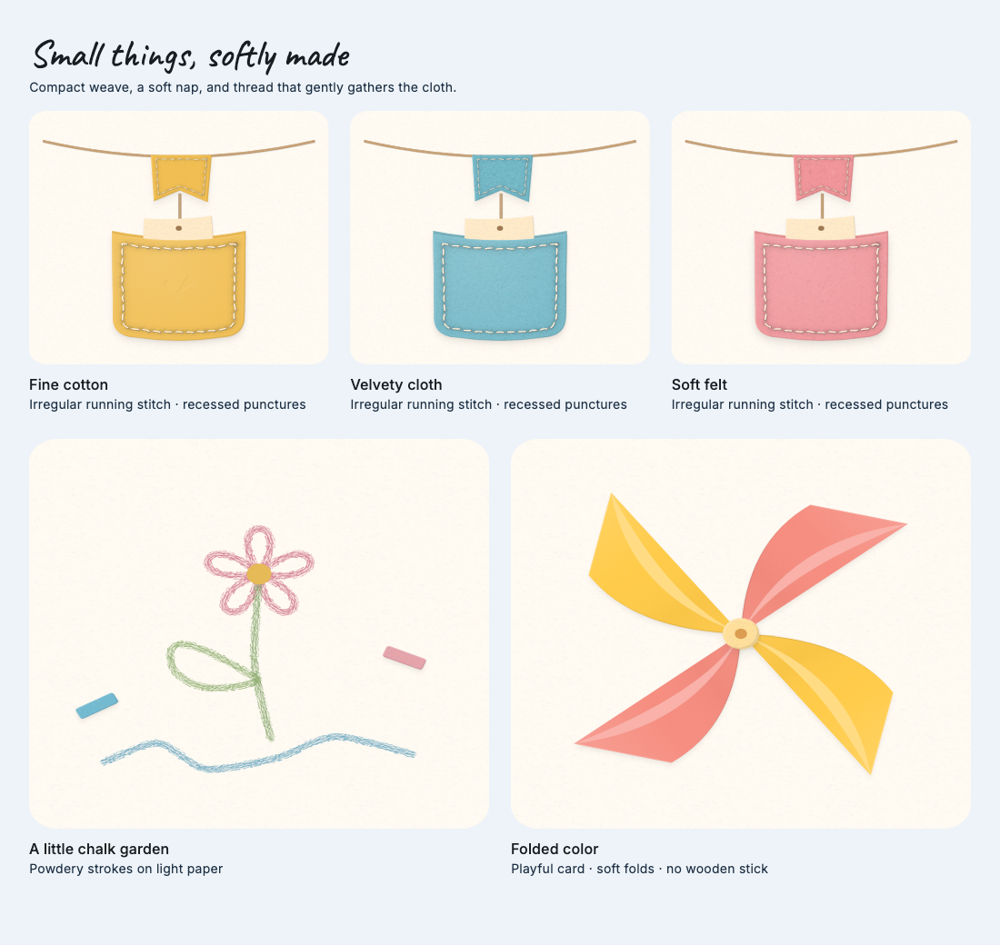

# Soft cloth, hand sewing, chalk and folded card

The shared example uses original procedural pocket, flower and blade geometry.
It imports no consumer artwork. Substrate, sewing, dry marks and fold lighting
are separate: they can be reused without adopting the example's objects.



## Cloth and thread

`CraftMaterial.cotton` adds a fine compact plain weave. `CraftMaterial.suede`
adds short directional nap, an illustrative velvety textile rather than a claim
about its manufacturing or fiber content. Existing linen, twill and felt pixels
are retained. Both additions use the same owner-scoped `MaterialTextures` cache,
96px tiles, clipping, grain strength/scale and disposal contract.

Prepare sewing outside paint and retain it until the cut, size or recipe changes:

```dart
final seam = insetCraftPath(pocketOutline, distance: 10);
final stitches = runningStitchPath(
  seam,
  dash: 7,
  gap: 4,
  irregularity: .75,
  seed: 83,
);
```

Inside your painter, reuse the prepared geometry and clip all shading to cloth:

```dart
canvas.save();
canvas.clipPath(pocketOutline);
CraftStitchFrame.sample(stitches, progress: progress).paint(
  canvas,
  thread: threadColor,
  width: 1.6,
  compression: .95,
  pucker: .8,
);
canvas.restore();
```

- `irregularity` (0..1) varies stitch length, angle and bow. The seeded path
  remains deterministic; zero retains the original regular path, independent
  of seed. Endpoints stay within the original visible span's arc interval.
  Curves are sampled at most 0.5px apart, with at most 18432 stations. Normal
  displacement is at most 1.5px at samples; reserve 1.75px including the
  polygonal approximation. Irregular output rejects more
  than 1024 stitches before painting; regular paths keep their existing budget.
- `compression` shades the puncture. `pucker` (0..1) adds a wider soft depression
  and paired short creases, multiplied by compression. It is available on
  running/patterned painting and prepared frames. Zero preserves legacy pixels.
- Reserve width * 7 around punctures for gathering, plus 1.75px when geometry is
  irregular; inset farther when that footprint must stay away from an edge.
  Explicit clipping prevents shading floating outside cuts or across holes.
- A partial stitch has no new puncture at its travelling tip. The prepared frame
  preserves that contract with gathering enabled. Caller progress supplies time;
  reduced motion should supply one and the host pauses its clock offscreen.

This changes thread geometry and light, not the cloth mesh. No fabric displacement,
needle simulation, tension solver or physical depth is promised.

## Chalk with more body

The existing chalk tool accepts `CraftStrokeStyle.dryCoverage` (0..1). Zero
preserves the original deposits; larger values add overlapping dry grain with
small seeded offsets. This also works for pencil/wax and is inactive for wet
tools. Width, pattern, seed and reveal remain independent.

```dart
paintCraftStroke(
  canvas,
  drawing,
  color: chalkColor,
  style: const CraftStrokeStyle(
    tool: CraftStrokeTool.chalk,
    width: 6,
    variation: .9,
    dryCoverage: .85,
  ),
  seed: 63,
);
```

No background-colored erasing, blur, layer or image is used. The existing shared
8192px decorative path limit remains; density is bounded to at most eight marks
per station and 8224 distance stations including contour endpoints. This is not
the long freehand capture API.

## Satin folded card

`paintPaperFinish(..., finish: PaperFinish.satin)` applies one clipped directional
sheen to an existing substrate; ink/highlight, strength and scale retain the
normal finish validation contract. It is seed-independent; scale does not alter
the bounds-relative sheen. The example separately builds blade cuts, a return
fold and broad gradient light, using ordinary Flutter paths and existing relief.
There is no exported pinwheel preset, wooden support, optical coating model or
wind simulation. Fold geometry belongs to the example, material sheen to the
package. Text and controls remain native.

Run the gallery and choose **Cloth, chalk & folds**. The same `SoftCraftSamples`
widget supplies the capture (`flutter test tool/capture_soft_craft.dart`) and live
controls. No golden baseline is regenerated by this command. Phone throughput
and visual approval remain separate from deterministic test/capture checks.
