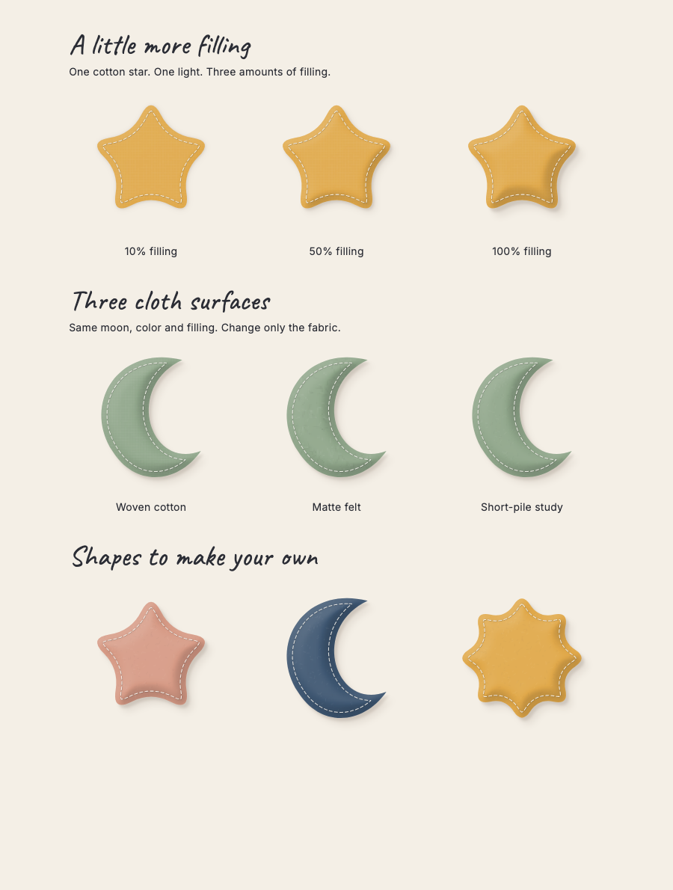
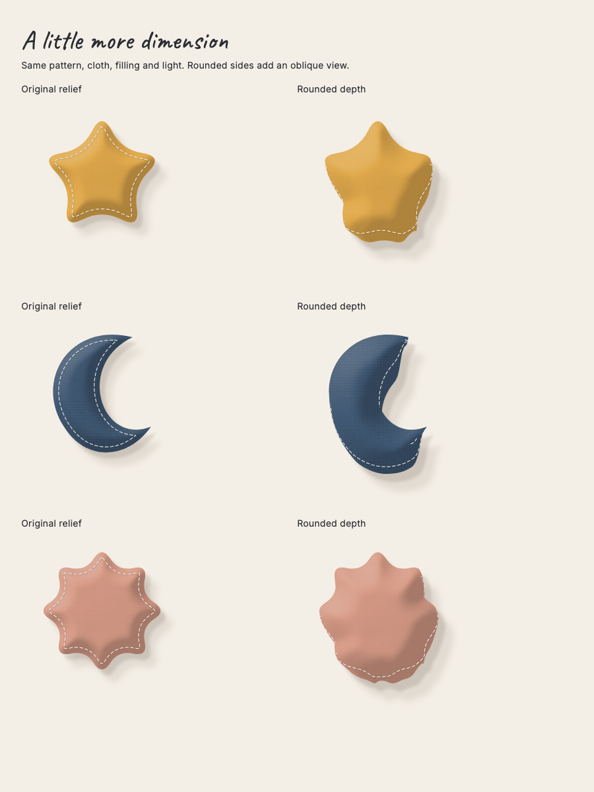
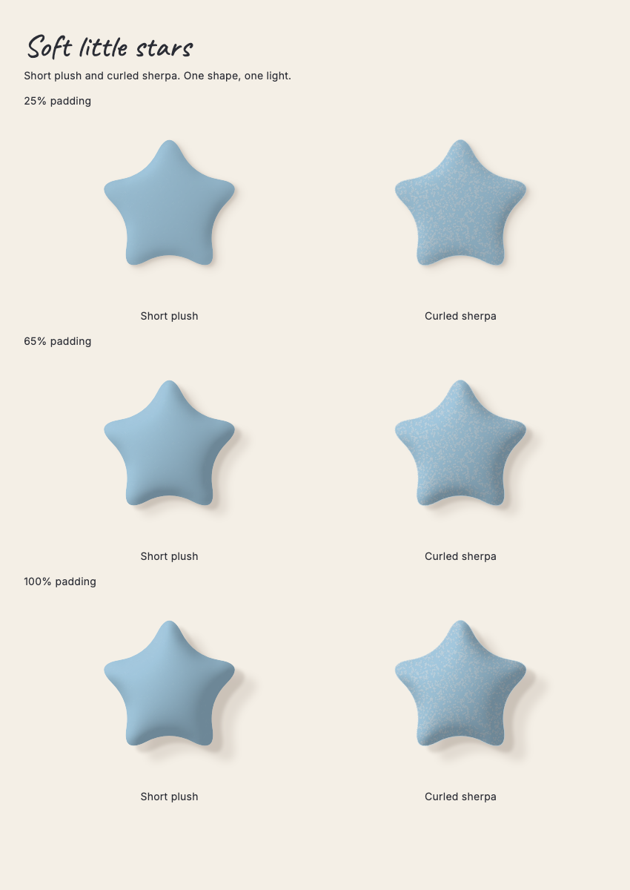

# Stuffed shapes: cloth and filling

[Try Stuffed shapes](https://moisesaguiarjunior.github.io/handcrafted_flutter/?study=pillows).
This first recipe composes the existing `CraftVolume`, `MaterialTextures`,
`CraftNap`, contour inset and prepared thread on original star, crescent and sun
cuts. It adds no new package export, textile enum, clock or cloth solver.



## Research before naming a material

Sources were checked on 2026-11-20. They inform qualitative visual differences,
not fitted simulation constants. No photographs, sewing patterns, branding or
proprietary textile assets are copied into the renderer.

| Fabric | Evidence and visual direction | First recipe |
| --- | --- | --- |
| Woven cotton | A visible weave; relatively restrained stretch and a tauter stuffed face. A cotton quilting fabric is a useful baseline. | Existing cotton tile, pale seam and prepared rounded volume |
| Felt | Pressed/matted fiber rather than an interlaced weave; useful for small cut forms and visible hand sewing. | Existing felt tile, independently of the same filling profile |
| Short-pile plush / minky | A knit base with directional nap; pile and stretch influence the soft rounded result. Manufacturer examples span different pile heights/stretch. | **Matte short-pile study**, using existing CraftNap; not a claim to reproduce minky |
| Fleece | A brushed knit worth comparing for a more uniformly soft surface. | Candidate; not relabelled felt or minky |
| Velour / velvet-like pile | Directional pile and sheen would require a separate visual proof. | Deferred: current CraftNap is matte and supplies no specular finish |
| Linen | Existing woven texture is available for a drier decorative cushion. | Optional future composition; not one of the first three comparisons |

Primary references:

- [Choly Knight, Plush Sewing Basics](https://cholyknight.com/wp-content/uploads/2018/04/plush-sewing-basics-ebook.pdf), choosing fabrics and fabric anatomy: woven/knit/nonwoven distinctions and the effect of stretch on stuffed form.
- [Shannon Fabrics, Cuddle family](https://www.shannonfabrics.com/cuddle) and [low-pile technical tip sheet](https://www.shannonfabrics.com/download_patterns/Quilting-Cuddle-Tip-Sheet.pdf): different plush constructions should not be represented by one unqualified texture name.
- [Robert Kaufman, Kona cotton](https://www.robertkaufman.com/print/fabrics/kona_cotton/?rk_cleanup_done=1): a plain cotton quilting reference.
- [National Nonwovens, Arts & Education](https://www.nationalnonwovens.com/markets/arts-education/): felt as a distinct craft textile family.
- [Fairfield, fillers](https://www.fairfieldworld.com/shop-fillers/): soft-object filling includes multiple fiber and bead constructions. This proof does not infer a physical material from one slider.

The choice to start with cotton, felt and matte short pile is our implementation
judgment. It is not a manufacturer endorsement or physical textile certification.

## Filling is separate from fabric

`StuffedShapeGeometry` takes a caller-supplied closed path and `filling: 0..1`.
The value controls the existing rounded profile's nominal height (.6..18 source
pixels) and edge roll (3..14 pixels). Zero retains a thin sewn shell; it does not
make the fabric transparent. The same cut, inset, seed and sewing geometry remain.
The percentage displayed by the study is **visual fullness**, not fill mass,
density, pressure or a measured percentage of physical internal volume.

The narrower roll avoids using an overly broad distance field on star arms,
which produced angular ridges in an earlier local comparison. This is still an
approximate height field; complex narrow forms can show ridges. It is a starting
proof, not a solved soft-body surface. Low-fill wrinkling, fabric stretch, seam
tension, compression, rebounds and silhouette deformation are not implemented.

Fabric, color, thread visibility/pressure and light are paint-only choices over
the prepared geometry. Filling or cut changes prepare a new field outside paint.
Relighting does not rebuild it. Cotton and felt use existing grain; short pile
uses four prepared fiber paths with tinted, low-contrast highlights. The latter
has no fuzzy silhouette, long fur, anisotropic sheen or fabric displacement.

Sewing uses the actual contour inset, including the moon's concavity. Thread is
pale and gently irregular; compression controls existing puncture shading and
is not a physical stitch depth. This visible topstitch is decoration: real
turned-seam cotton/plush can hide the joining thread. The recipe does not claim
one visible seam style is the construction of every real textile.

## Geometry, ownership and use

The three presets live in the example; applications can supply another closed
cut under **all** existing volume/nap/inset/stitch limits. The source artboard is
112px, displayed independently of native labels/controls. Sharp or thin details
may lose an inset region; caller cuts must leave room for their chosen sewing.
The example keeps the existing 320-segment volume cap and 8192-candidate nap cap.

```dart
final geometry = StuffedShapeGeometry(myClosedCut, filling: .65);
final textures = MaterialTextures(seed: 71); // retained by the widget owner
geometry.paint(canvas, textures, sceneLight,
  fabric: PillowFabric.cotton, color: myOpaqueColor);
// When the owning scene ends:
textures.dispose();
```

`StuffedShapeGeometry`, `PillowFabric` and the silhouettes are example-owned,
not imports from `package:handcrafted_flutter/handcrafted_flutter.dart`.
Shading assumes an opaque substrate on a board; this does not export a transparent
sprite. Existing native image/mesh disposal and owner-scoped textures remain;
there is no global cache or animation controller. Decorative paint ignores
pointers and semantics; the dropdown, slider and switch are native widgets.

From the example directory:

```sh
flutter run -d chrome -t lib/main_gallery.dart
# Select Stuffed shapes, or open ?study=pillows on the hosted gallery.
flutter test test/stuffed_shapes_test.dart
flutter test tool/capture_pillows.dart
```

Captures use the actual study painter. Comparisons isolate filling on the same
cotton star and fabric on the same moon/color/filling/light. No existing golden
is regenerated. This demonstrates a runnable recipe; visual acceptance for an
application and performance on Android/iPhone remain separate gates. Do not
introduce fabric-specific physics or promote a pillow API before that evidence.

## Optional rounded depth

The original relief remains the default. **More depth** selects a second,
example-owned 2.5D projection with a rounded side envelope and sewing at its
mid-section. **Raking light** independently selects one lower directional light
for every shape. The comparison uses that same explicit light in both columns.



`StuffedShape(moreDepth: true)` opts in; `PillowDepthGeometry(original)` prepares
the alternative. Both remain example types. The original cut, filling, seed and
fabric inputs are reused. Existing CraftVolume/CraftNap and thread supply all
lighting/grain/sewing; no new package mesh renderer or animation clock is added.

The projected body is a union of sixteen tapered cross-sections of the same
pattern. A bounded local-coverage heuristic reduces depth near thin tips, rather
than extruding a moon tip into a blunt vertical wall. There are at most 320
contour stations, 64 coverage probes per station, four scalar smoothing passes
and sixteen section unions. The larger result must still satisfy the existing
volume and nap budgets; some cuts accepted as a front can exceed the side budget.
All geometry/occlusion work is prepared before paint, not during relighting.

One cloth field covers the whole projected envelope, avoiding a stack of shaded
flat cutouts. The original front projection masks the far-side sewing; only the
exposed join is painted. A pale thread and one ground shadow provide depth cues.
This is a fixed oblique illustration with approximate normals/occlusion, not a
rotatable solid, perspective camera, cloth solver or physically lit closed mesh.
Narrow shapes and arbitrary holes require their own visual validation.

Depth reserves a 160px source window instead of 132px while retaining the same
base source-to-display scale. The `size` argument controls the base front-panel
scale; the deeper widget intentionally occupies a larger square to leave room
for its body/default shadow. Native text/control sizes are independent of it.
Extreme user-supplied lights can need additional caller-owned shadow clearance.

Preparation is more expensive than changing paint. The depth slider updates its
label while dragging and commits geometry at release, including native keyboard
adjustments; original-relief dragging remains continuous. An exploratory desktop
JIT preparation probe motivated simpler section unions instead of many bridge
polygons. These debug samples do not establish frame times, mobile FPS or GPU
memory, and do not complete the general performance-baseline roadmap task.

The approved original comparison PNG remains unchanged. The capture command also
writes `build/pillows/depth-comparison.png`; compare the original output against
`docs/assets/stuffed-shapes.png` under the matching engine/fonts instead of
regenerating that reference. Deeper fabric, mask, native-control and pixel tests
cover the optional path. Device profiling and application visual adoption remain
separate gates.


## Whole-face padding: short plush and curled sherpa



A separate opt-in section in `?study=pillows` compares two textile finishes on
exactly the same original star, color, filling and light. The earlier relief and
oblique-depth recipes remain available; their comparison images are unchanged.

`CraftVolumeProfile.padded` reuses the canonical grid, normals, light, shadows
and mesh disposal. It prepares a smooth whole-face approximation with 320 fixed
four-neighbor relaxation sweeps on a scale-aware lattice (at least 2px spacing,
at most 62 stations per axis), then normalizes a
square-root dome to `height` and uses the existing three smoothing passes.
The larger source cuts use a coarser lattice so diffusion reaches across the
face instead of staying near its edge. This bounded visual approximation is
not an equilibrium cloth solver, stretch model or physically calibrated stuffing.
`bevel` remains validated for compatibility but does not control this profile.
At the maximum 3,844 padded stations it visits at most 1,230,080 relaxation stations,
in addition to sampling, normalization and the shared smoothing/normal work.
Preparation stays outside paint. Smaller shapes and disconnected lobes can have
unequal apparent fullness; fine details can lose volume on the coarser lattice,
and holes remain clipped by the original cut.

`PlushPillowGeometry` lives in the example. Short plush reuses `CraftNap` with
fine low-contrast fibers. Curled sherpa adds seeded, overlapping small tuft
lobes in four retained tonal paths; changing light changes their highlight
shift and the shared body shading. At most 8,192 tuft candidates are allowed,
three lobes each; the existing nap budget also applies. This is a deliberately
subtle illustrative finish, not fiber scattering or a 3D mesh. A short, bounded fringe softens only
the sherpa silhouette; it does not model long fur.
The new specimen hides sewing by default; the optional pale junction stitch
has no dark puncture shading. Native padding commits on release or keyboard
adjustment and relighting repaints the same retained geometry.

The qualitative distinction is informed by the manufacturer's
[short-pile overview](https://www.shannonfabrics.com/cuddle) and
[textile comparison sheet](https://blog.shannonfabrics.com/hubfs/STT_Jan5_final.pdf)
(checked 2026-11-20). No product photos, commercial patterns or textile images
are redistributed; all cuts and tuft geometry are original code.

Capture with `cd example && flutter test tool/capture_pillows.dart`:
`build/pillows/plush-comparison.png` compares 25%, 65% and 100% padding. This is a
new visual study, not a replacement golden or a claim of owner approval.
Android/iPhone performance remains unmeasured.

### Source compatibility

The new enum case is additive in source but requires updating exhaustive
`CraftVolumeProfile` switches. Existing `sheet` and `rounded` outputs and enum
indices are preserved. This is included in the 0.4.0 source release; see the
[migration guide](releases/0.4.0.md). Prior tags and hosted archives are unchanged.
