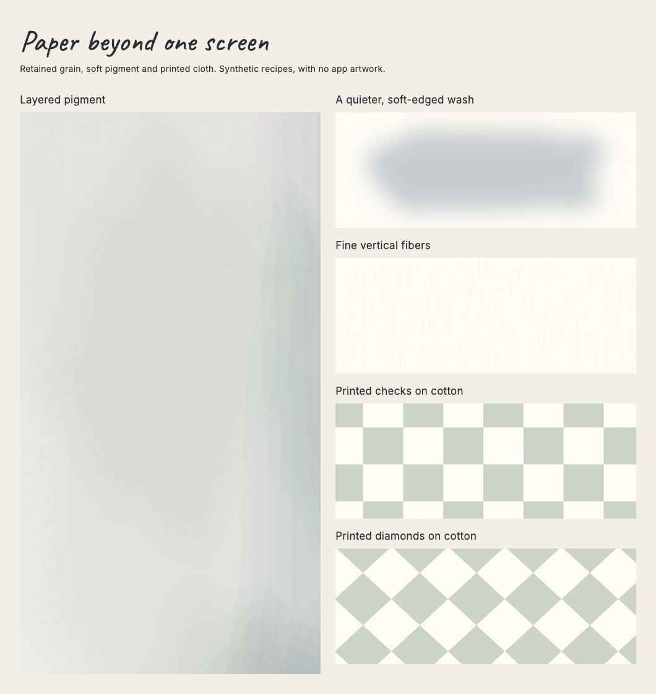

# Continuous surfaces and repeated prints

These are **synthetic example recipes**, not new public materials or a claim of
visual equivalence to an application's artwork. The existing painters keep their
default silhouette, seed, resource ownership and work limits.



## One source domain, many viewports

`MaterialTextures.paint` anchors its shader to the supplied outline bounds.
`paintWatercolor` derives puddles from those bounds as well as the seed. Rebuilding
an outline for every scroll strip changes the source, even with the same seed.

The example records a 960 × 1728 logical-pixel source once, then clips/translates
that picture for each viewport. It retains the owner and source until disposal.
The scroll example paints one continuous field; the strip option is an explicit
raster experiment, not a recommendation to prepare each strip independently.

```dart
final scene = SurfaceProof(recipe: SurfaceRecipe.watercolor);
// Inside paint: viewport is in source coordinates, output begins at (0, 0).
scene.paintViewport(canvas, const Rect.fromLTWH(73.25, 417.5, 320, 256));
// When the example scene ends:
scene.dispose();
```

`SurfaceProof` belongs to `example/lib/surface_proofs.dart`; it is deliberately
not exported by the package. Native text and controls are outside its decoration.
For an application, retain the same source/seed while scrolling and rebuild only
when the material recipe changes.

### What the proof establishes

A synthetic viewport at fractional coordinates is compared at 1× and 3× against
64px clips of the same retained source. Repeated whole-viewport rasterization is
identical in this engine. Strip clipping has **measurable raster differences**;
it is not pixel-equivalent. The initial Flutter 3.47.9 test-engine sample observed
maximum channel deltas of 1–9 out of 255 and mean channel deltas below 0.16.
The regression guard bounds isolated differences at 10 and uses recipe-specific
all-channel mean limits: layered wash 0.1, soft field 0.2, fibers 0.01, checks
0.03 and diamonds 0.05. Native and headless Chrome samples informed these bounds.
The negative control constructs and disposes a fresh source in **every strip**,
then requires that composite to fail the same metrics/bounds at both scales.
These diagnostic bounds are not a visual acceptance threshold for a consumer.

The mask case at 3× has many small rounding differences, so a low mean must not
be mistaken for identical pixels. The generated report includes changed-channel
counts, maxima, means and the deliberate source-restart counterexample. Further
cross-engine and visual comparison is required before adopting clipped strips.

The example also restricts all absolute source coordinates to ±8192; a finite
but excessive origin (such as 1e12) loses precision in native path storage and is
explicitly rejected before recording. This is an example limit, not a new package
contract.

The 2048 logical-pixel limit **per axis** still applies to these painters; the
1024px widget-decoration fallback is a separate contract. A 2300px source is
rejected by the proof. This does not implement an unlimited document, chunked
wash synthesis or a new texture-origin API. First validate the bounded recipe;
a larger-world contract remains a separate request.

## A quiet wash with a soft alpha edge

The soft-field recipe combines a nearly uniform native pigment fill with a very
subtle `paintWatercolor` overlay and an existing `pigmentOutline`. A native
Gaussian alpha mask controls the edge independently of core opacity. Applying
the mask twice selects a tighter transition curve; an ellipse is an alternative
to the seeded irregular outline.

The mask is painted into a **whole transparent layer** composited with `dstIn`.
Drawing just a `dstIn` path directly would leave unwanted ink outside the path.
Blur and layers apply to the decoration only. `paintSubstrate: false` demonstrates
transparent export: the test checks a clear corner, nonzero center alpha and a
multi-level transition. Feathering is an optical approximation, not diffusion.

`coreOpacity`, `feather`, `tightFeather` and `irregular` are separate example
parameters. Feather is Gaussian sigma in source pixels, not an exact finite fade
width. No default package painter, text layer or semantic tree is blurred.
The extra offscreen layers have a cost; a softer appearance is not a free upgrade.

## Fine fibers, checks and diamonds

The existing paper tile suggests paired creases. The fine-fiber recipe instead
uses bounded native strokes on a flat substrate. Direction, mean length, density
and alpha are independent. Seeded variation stays small and the mark count caps
at 4096. Density is fibers per 10,000 source square pixels, so the cap reduces
effective density on larger fields. This is an example overlay, not a new paper
family or a replacement for laid/recycled finishes.

Checks and diamonds share a 64px source-space cell, seeded phase and explicitly
supplied phase offset (bounded to ±4096 source pixels). Diamonds rotate the same print geometry. Native shapes
print translucent sage over the existing cotton substrate; there is no global
color filter, private palette or recoloring of content. The substrate, print
color and print geometry remain separate. Zero cloth strength can use the same
print as wallpaper; wallpaper is composition rather than a new material enum.

## Run and inspect

From the example directory, after dependency resolution:

```sh
flutter run -d chrome -t lib/main_surfaces.dart
flutter test test/surface_proofs_test.dart
flutter test tool/capture_surfaces.dart
```

The capture command uses the actual renderer, writes a specimen board and 1×/3×
crops, and saves `build/surface-proofs/report.json`. It reports cold source
recording separately from first/warm raster-and-RGBA-readback wall time. These
are exploratory single samples, include engine scheduling/readback and are
neither frame timings nor GPU allocations. Use the existing rendering-budget
harness and physical-device profiling for performance decisions; do not infer
mobile FPS from this script. All temporary pictures/images and owned tiles are
disposed. No existing golden is regenerated.
