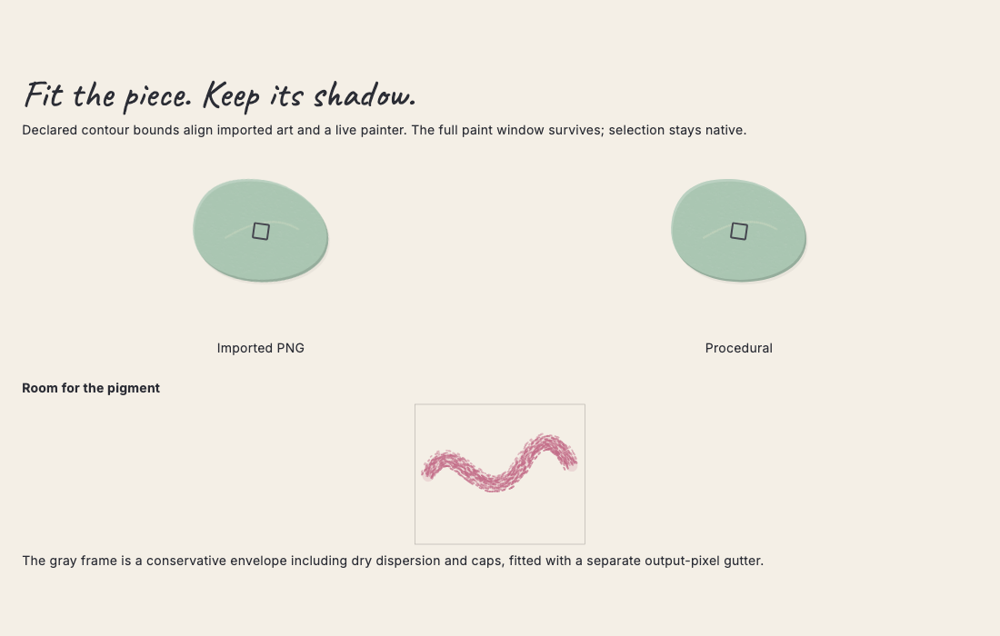

# Fit a contour, retain its paint



[Try imported artwork](https://moisesaguiarjunior.github.io/handcrafted_flutter/?study=imported).
The original pebble is both a padded PNG and a live painter; native checkboxes
remain independent of source-image scaling. The comparison uses a fixed local
reference light. It demonstrates placement, not runtime relighting of baked PNG
pixels. Its source-over paper/relief recipe supports transparent PNG output;
it does not export the opaque-substrate volume mesh as a sprite. Scene-lit
procedural volume can separately use CraftLight.inLocalSpace.

## Two rectangles, one placement

`CraftPlacement.fit` separates the complete source painting window from the
rectangle that describes the visible contour. It uniformly contains that declared
rectangle in a target and aligns it using Flutter Alignment. Source pixels
outside the contour rectangle remain in the placement: padding, bevels and short
shadows are not silently cropped. No alpha scan or silhouette reconstruction
occurs; the caller supplies trustworthy bounds.

```dart
final placement = CraftPlacement.fit(
  sourceRect: const Rect.fromLTWH(0, 0, 180, 140), // full paint window
  visibleBounds: const Rect.fromLTWH(42, 30, 96, 72),
  target: targetRect,
  pose: suppliedPose,
);
final part = CraftImagePart.placed(
  key: const ValueKey('choice'),
  image: const AssetImage('assets/piece.png'),
  sourceSize: const Size(180, 140),
  placement: placement,
  child: nativeOverlay,
);
final attachment = placement.mapSourcePoint(authoredSourcePoint);
```

The output `rect` is the **full** painting window in the parent's Stack, so it can
extend beyond the visible target. Reserve its transformed extent in ancestors;
Flutter cannot hit-test outside an ancestor. The default hinge is the visible
center; an explicit source hinge can be external. Alignment must be finite in
[-1,1]. The source and visible rectangles must be finite, positive and contained;
underflow/overflow that prevents a positive finite transform is rejected.
A retained margin that loses fitted-contour precision is rejected too: unposed
visible corners and center must map back within1e-7 times each fitted axis
extent (with a1px extent floor). Correcting anchors alone would leave painting
misaligned, so the whole placement fails. Collapsed decorative areas skip painting.

`CraftPlacement(sourceRect: ..., rect: ...)` retains explicit stretching for
existing callers. `CraftImagePart` delegates its geometry and attachment mapping
to this same object, keeping its existing constructor and wrapper topology.
Painting/input still use CraftPart/PartPose's single native transform; the helper
does not create a second pose matrix or a clock.

For procedural content, compose `Positioned.fromRect(rect: placement.rect)` and
CraftPart with `placement.pose`, `placement.pivot` and `placement.rect.size`.
Inside the painter, scale by `scaleX/scaleY` and subtract `sourceRect.topLeft`.
Clip to the full painting window if matching an imported crop. The example
`placement_studies.dart` does exactly this and overlays an unscaled 48px native
checkbox. Controls still own their labels, focus, minimum targets and visibility;
a source/pose scale is not automatically an accessibility policy.

A visible rectangle is not a hit mask. Existing `sourceClip` still clips image,
overlay and input together; a contour mask can also trim a halo outside that
contour. Use native controls in their intended regions and reserve padding for
paint. Source coordinates can differ from decoded pixels: the example's 180×140
window is authored at 2× raster density.

## Conservative decorative stroke bounds

```dart
final bounds = craftStrokeBounds(path, style: chalkStyle);
// Use these bounds, not just path.getBounds(), when reserving layout space.
paintCraftStroke(canvas, path, color: color, style: chalkStyle, progress: progress);
```

`craftStrokeBounds` reuses the actual style/path/span validation and dry instrument
formulas. It includes maximum normal/forward dispersion, grain length, round
caps, brush dabs and native miter clearance. Seed and color do not change its
conservative envelope. An added `rasterPadding` defaults to two local units;
it must be finite and nonnegative. No painter/cache/image is created by the
measurement. Native pen/marker painting now explicitly uses its existing default
miter limit4 so measurement and paint share that constant.

This is **not tight alpha bounds**. Flutter path bounds can include control-point
overshoot; the dry envelope deliberately uses a conservative L1 sum. Nonzero
progress retains the complete source envelope for stable reveal layout. Zero
progress/no drawable spans return Rect.zero, while invalid input still fails.
For a reveal, measure with default progress1 and paint with the supplied progress;
do not fit an empty initial rectangle. Freehand input retains its separate point
budget/API and is not measured by this decorative-path helper.

The result is in untransformed local coordinates. At unit scale and DPR>=1,
two local units cover the fringe in native/browser raster checks. When scaling down, reserve at least
two output-device pixels **after** mapping, or supply enough inverse-scale local
padding. The example leaves an additional8px output gutter. Rectangular clipping
can change native subpixel quantization even away from the boundary; this API
guarantees a conservative envelope, not byte identity between different clips,
DPRs, renderers or transforms.

## Pocket controls stay with the example recipe

`FabricComposition` and `PocketGeometry` now expose opening0..1, fold depth1..14
and front height.5..8 in source/artboard units. `seamCompression`0..1 and existing
insertion progress are independent paint inputs. Geometry is retained through
insertion/pressure/relighting; changes to opening, fold or front height prepare
a replacement outside paint. Defaults retain the original pocket capture.

The back, mouth/cavity, note, front, applique, folds and lip keep their paint
order. The front still hides the inserted note. Source-specific cuts, palette,
note travel and attachment layout remain an example, not a public pocket preset
or cloth simulation. Public promotion still needs independent consumer evidence.
The volume gallery offers all four new native controls next to insertion.

## Reproduction and limits

- `python3 tool/verify_stroke_parity.py`: 432 exact raster comparisons with the
  immutable pre-extraction renderer6800c59; temporary source is removed afterward.
- `flutter test tool/author_placement_asset.dart`: author the original PNG from
  the same procedural painter, including its retained shadow window.
- `(cd example && flutter test ../tool/capture_placement.dart)`: actual gallery
  widgets at wide/320/390/428 layouts. The capture disables theme interpolation
  so the intended fonts are present from the first image.
- Package tests check every painted pixel against reported bounds across all six
  tools/three patterns, widths/coverage/seeds, plus acute native miters. Placement
  tests compare independent anchor positions and actual native taps for raster/
  procedural representations and retain a visible marker outside the fit bounds.

The source/path/pose work limits and the package's opaque-substrate lighting
requirements still apply. This work adds no art manifest, alpha-scanning service,
second clock or global cache. Android/iPhone measurements and physical assistive
technology sessions remain outside this delivery.
